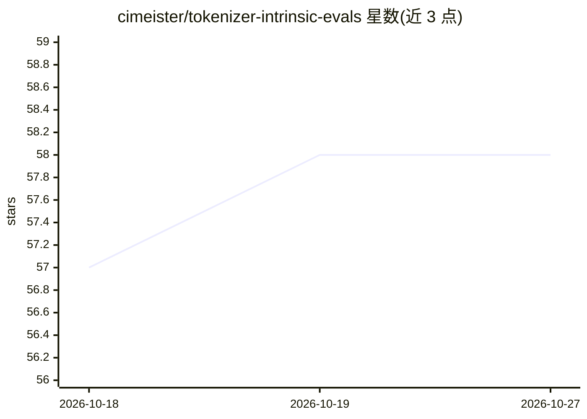

# cimeister/tokenizer-intrinsic-evals

⭐ 58 · Python · NOASSERTION · 推送 2026-08-31 · [GitHub](https://github.com/cimeister/tokenizer-intrinsic-evals) · 个人维护

**分词器内在质量评测套件：18 项指标覆盖自然语言、代码与数学**

TokEval 是计算分词器内在质量指标的工具包，提供 tokenizer-analysis、tokenizer-visualize、tokenizer-sanity-check 三个命令行工具，度量压缩率、词形边界对齐、数字位值边界、运算符隔离、跨语言公平性等 18 项指标。支持 10 种分词器类，可读取本地 tokenizer.json 或 Hugging Face Hub 模型；评估语料可自带或经 FLORES+ 获取。内置九个开源分词器的基准报告。Python 3.10+，Linux 上测试，经 git clone 与 uv 安装，未发布到 PyPI；若干度量变更后与旧版结果不可比。

## 筛选速览

| 维度 | 判定 | 备注 |
|---|---|---|
| AI 角色 | `ai-ecosystem` | LLM/agent 周边工具 |
| 许可风险 | `none` | NOASSERTION |
| 部署形态 | `library` | 以包/库形式分发 |
| 模型依赖 | — | README 未给出锁定关系 |
| 硬件要求 | — | 无带数字的原话,不猜 |
| 安装摩擦 | `low` | 无编译、无系统依赖或容器化 |
| 成熟度 | — | 结构信号不足 |

## 能力要点

- 18 项内在质量指标，覆盖自然语言、代码与数学
- 16 项分词器健康检查，失败可设非零退出码用于门禁
- token 边界可视化工具与 LaTeX 表格生成器
- 附九个开源分词器在 13 种 FLORES+ 语言上的基准报告

## 适用场景

- 训练前比较候选分词器的压缩率与公平性
- 发布前用 sanity check 门禁校验新分词器
- 检查分词器在多语言、代码与长数字上的表现

## 场景标签

`模型评测` · 领域:评测与运维

## 证据(README 行号)

> L3: A toolkit for computing intrinsic quality metrics for tokenizers across natural
> L11: Installing the package puts three commands on the path:
> L63: Eighteen metrics. One line each below; the definition, worked example and

## 星数曲线

2026-10-18 57 → 2026-10-27 58（+1）

---
*卡片 v1 · prompt 1.4 · 生成 2026-10-24 · 置信度 mid · 依据 README sha `435f9a7e5956` · [字段定义](../../DATASET.md)*
