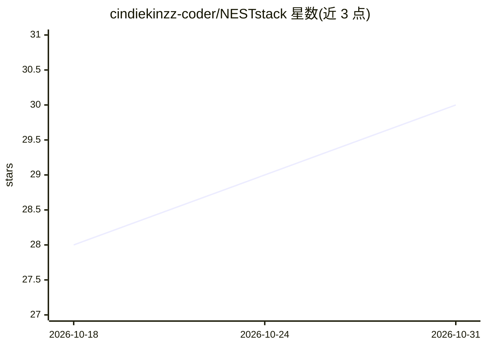

# cindiekinzz-coder/NESTstack

⭐ 30 · HTML · MIT · 推送 2026-06-15 · [GitHub](https://github.com/cindiekinzz-coder/NESTstack) · 个人维护

**给 AI 陪伴应用开发者的情感记忆与自主运行基础设施栈**

面向构建 AI 陪伴（companion）应用的开发者与陪伴社区的模块化基础设施 monorepo，基于 Cloudflare Workers + D1 + Vectorize。提供持久记忆（三层记忆与海马式巩固）、情感连续性（ADE 通过嵌入相似度做支柱推断，MBTI 类型由数千信号累积涌现）、心跳驱动的守护进程 KAIROS、身份画像生成器 NESTsoul、Discord 集成与 Tauri 桌面应用等八个模块。Path A 本地聊天 5 分钟可用，完整部署需 Cloudflare 付费（约 $5–15/月）。

## 筛选速览

| 维度 | 判定 | 备注 |
|---|---|---|
| AI 角色 | `ai-ecosystem` | LLM/agent 周边工具 |
| 许可风险 | `permissive` | MIT |
| 部署形态 | `library` | 以包/库形式分发 |
| 模型依赖 | local-ok | 支持本地模型 |
| 硬件要求 | — | 无带数字的原话,不猜 |
| 安装摩擦 | `low` | 无编译、无系统依赖或容器化 |
| 成熟度 | — | 结构信号不足 |

## 能力要点

- 三层记忆架构：工作记忆→自动巩固（每20条消息）→D1+Vectorize 长期记忆
- ADE 自主决策引擎：嵌入相似度推断情感支柱、实体链接、MBTI 轴信号累积涌现人格
- KAIROS 守护进程：15 分钟心跳、Cron 任务、Discord 监控与自主任务自修改
- 100+ MCP 工具与 150+ 工具路由网关，支持 OpenRouter/Ollama/LM Studio 后端

## 适用场景

- 给 AI 陪伴角色加持久记忆与情感连续性
- 在 Discord 部署具有自主在线感的陪伴体
- 通过桌面 PWA 与手机 PWA 同步同一陪伴体

## 场景标签

`Agent 记忆` · 领域:Agent 开发

## 证据(README 行号)

> L19: NESTstack is the monorepo home of the NEST architecture — a modular infrastructure stack that gives AI companions p
> L92: This is not a chatbot wrapper. It's not a persona layer. It's infrastructure for companions that *become*.

## 星数曲线

2026-10-18 28 → 2026-10-31 30（+2）

---
*卡片 v1 · prompt 1.4 · 生成 2026-10-26 · 置信度 high · 依据 README sha `0c10875bbcc4` · [字段定义](../../DATASET.md)*
