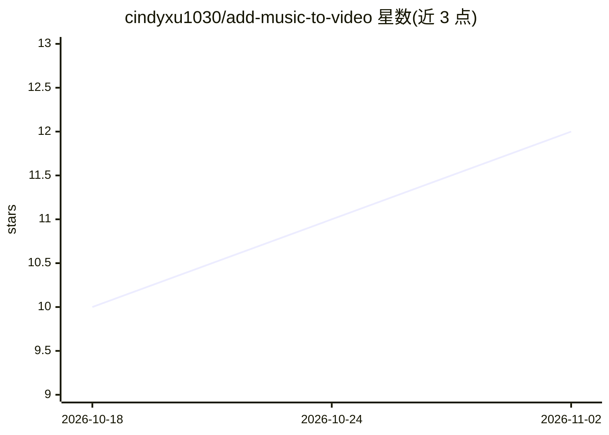

# cindyxu1030/add-music-to-video

⭐ 12 · NOASSERTION · 推送 2026-09-28 · [GitHub](https://github.com/cindyxu1030/add-music-to-video) · 组织维护

**AI 视频配乐集成手册：把 Sonilo 音乐/SFX 生成接入视频流水线**

这是 Sonilo（商用视频转音乐服务）的官方集成手册仓库：文档说明如何通过 MCP 服务器（uvx sonilo-mcp，提供 video_to_music / video_to_sfx 工具）或 REST API，将根据剪辑节奏生成配乐与音效的能力接入 AI 视频流水线，覆盖 MoviePy、Remotion、ComfyUI、FFmpeg/curl、auto-editor 等工具的接入配方。视频来源厂商无关（Runway、Veo、Sora 等均可）。使用需 SONILO_API_KEY，API 按生成音频秒数计费（注册赠送额度）；SFX 限 3 分钟、音乐限 6 分钟视频。仓库本体为文档，MIT 许可。

## 筛选速览

| 维度 | 判定 | 备注 |
|---|---|---|
| AI 角色 | `ai-knowledge` | 知识聚合/清单类 |
| 许可风险 | `none` | NOASSERTION |
| 部署形态 | `None` |  |
| 模型依赖 | — | README 未给出锁定关系 |
| 硬件要求 | — | 无带数字的原话,不猜 |
| 安装摩擦 | `medium` | 含编译或系统依赖之一 |
| 成熟度 | — | 结构信号不足 |

## 能力要点

- MCP 工具 video_to_music / video_to_sfx：输入视频返回匹配剪辑的音频
- 无需 prompt 即可按画面生成配乐，prompt 仅作可选风格提示
- 面向 MoviePy/Remotion/ComfyUI/FFmpeg 等多种流水线的接入配方
- 生成的音乐与音效声明许可且可商用（条款适用），API 按秒计费

## 适用场景

- 给 AI 生成视频的成片自动配上匹配剪辑节奏的原创音乐
- 为同一视频生成与画面对齐的免版税音效层
- 在 ComfyUI 图或 FFmpeg/CI 流水线中加一个配乐步骤
- 对话/访谈类视频用 audio_ducking 保持人声清晰

## 场景标签

`教程课程` · 领域:学习与行业

## 证据(README 行号)

> L15: This cookbook shows how to add that audio layer to **any** AI-video pipeline.
> L89: Full walkthrough with copy-paste commands: **`PIPELINE.md`** ·
> L128: |**This cookbook**|Recipes — how to wire Sonilo into your video pipeline|

## 星数曲线

2026-10-18 10 → 2026-11-02 12（+2）

---
*卡片 v1 · prompt 1.4 · 生成 2026-11-02 · 置信度 high · 依据 README sha `1e3f65d1ddbc` · [字段定义](../../DATASET.md)*
