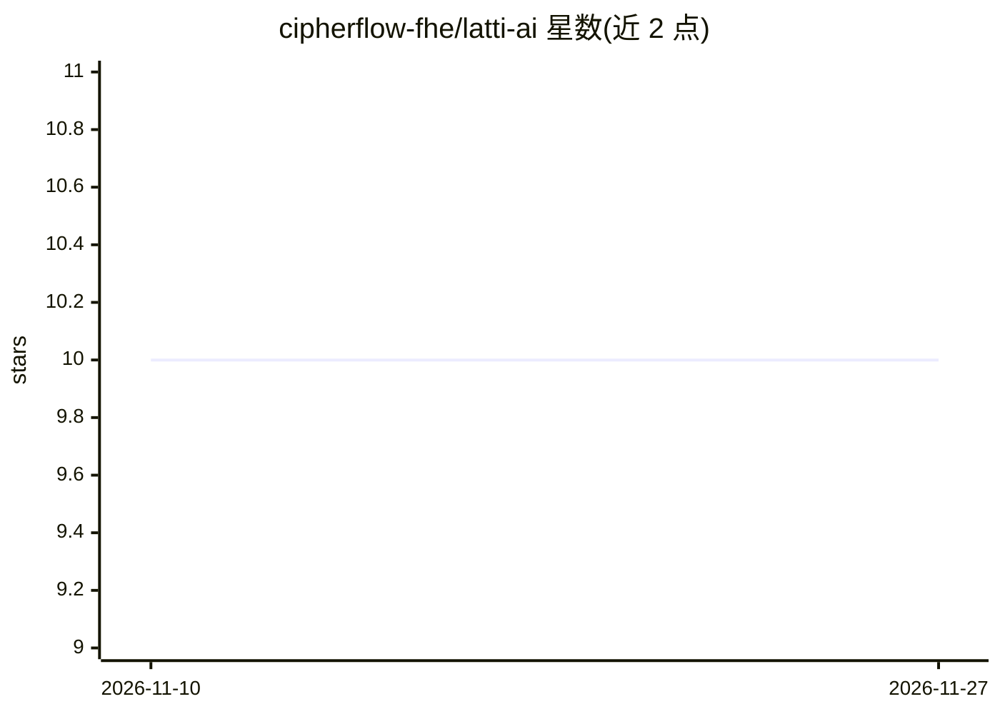

# cipherflow-fhe/latti-ai

⭐ 10 · C++ · Apache-2.0 · 推送 2026-11-26 · [GitHub](https://github.com/cipherflow-fhe/latti-ai) · 组织维护

**面向 AI 开发者的全同态加密模型推理部署框架**

LattiAI 是基于 CipherFlow 的 LattiSense FHE 框架构建的隐私保护 AI 推理开发平台，覆盖从 PyTorch 明文模型到加密推理服务的完整流水线。核心机制包括：多项式近似算子替换 ReLU/MaxPool 等非多项式层、模型编译器生成 CKKS 兼容计算图（DAG）并自动规划 bootstrapping、HE 算子库（卷积/全连接/AvgPool/BatchNorm）以及支持多线程 CPU 与 GPU 加速的运行时。推理全程数据保持加密，实现数据与模型双向隐私保护。通过 CMake 从源码构建，提供 CPU-only 与 GPU 两条构建路径。

## 筛选速览

| 维度 | 判定 | 备注 |
|---|---|---|
| AI 角色 | `ai-ecosystem` | LLM/agent 周边工具 |
| 许可风险 | `permissive` | Apache-2.0 |
| 部署形态 | `library` | 以包/库形式分发 |
| 模型依赖 | — | README 未给出锁定关系 |
| 硬件要求 | `cpu-ok` | |
| 安装摩擦 | `high` | 编译与系统依赖俱全 |
| 成熟度 | — | 结构信号不足 |

## 能力要点

- 多项式近似算子替换非多项式激活与 MaxPool，微调后精度接近原模型（验证于 ResNet、MobileNetV2、YOLOv5 等）
- 模型编译器从 .pth/.onnx 自动生成 CKKS 加密计算图并规划 bootstrapping 插入与数据打包
- HE 算子库基于 SIMD slot 编码向量化计算，bootstrapping 支持任意深度密文运算
- 运行时支持多线程 CPU 并行与 GPU 加速（经 HEonGPU）

## 适用场景

- 服务器不接触原始数据的前提下部署加密推理服务
- 模型持有者防止用户获取模型参数的推理交付
- 医疗/金融等敏感数据上的隐私保护图像分类推理

## 场景标签

`推理引擎` · 领域:训练与推理

## 证据(README 行号)

> L8: **LattiAI** is a development platform for privacy-preserving AI model inference, built on top of the LattiSense Full
> L10: LattiAI covers the complete pipeline from plaintext models trained with frameworks like PyTorch to encrypted infere
> L12: AI developers can complete end-to-end encrypted inference deployment without understanding the underlying cryptogra

## 星数曲线

2026-11-10 10 → 2026-11-27 10（+0）

---
*卡片 v1 · prompt 1.4 · 生成 2026-11-19 · 置信度 mid · 依据 README sha `8aacce87f401` · [字段定义](../../DATASET.md)*
