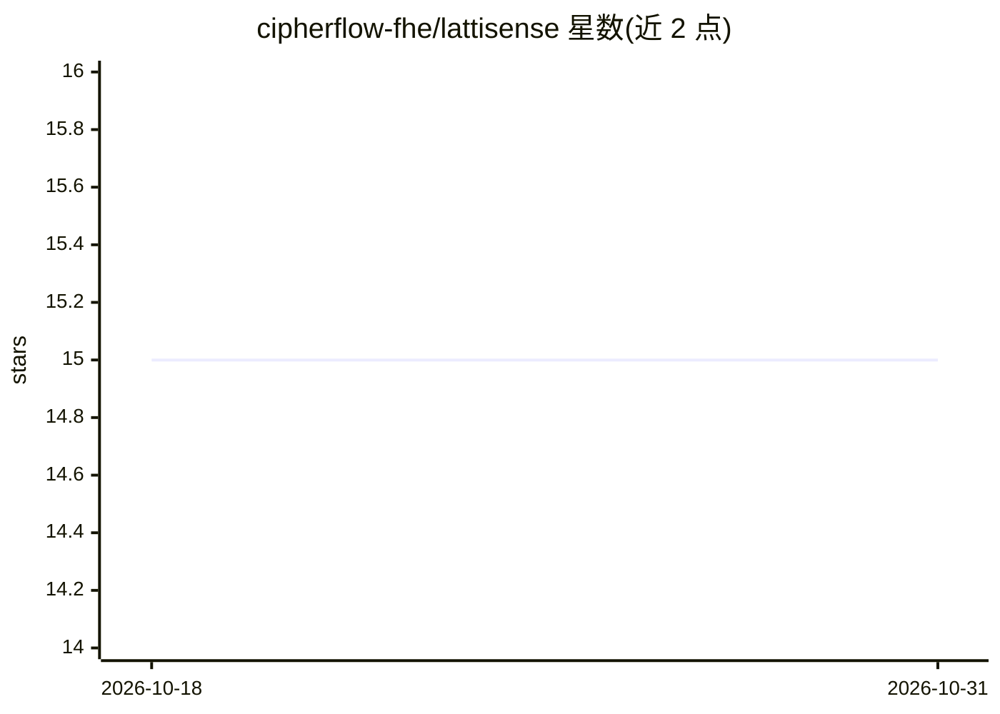

# cipherflow-fhe/lattisense

⭐ 15 · C++ · Apache-2.0 · 推送 2026-10-28 · [GitHub](https://github.com/cipherflow-fhe/lattisense) · [官网](https://cipherflow.ai/docs/) · 组织维护

**全同态加密（FHE）全栈开发框架：密文上执行计算**

由 CipherFlow 构建的 FHE 开发框架，统一抽象接口覆盖加密库、FHE 编译器、调度器与硬件加速四类功能：开发者用 Python 定义计算任务（如密文整数乘法），由 C++ SDK 在 CPU 或 GPU 上执行密钥生成、加密、计算、解密全流程，数据无需解密即可参与运算。集成 Lattigo、HEonGPU、SEAL 插件等外部库。限制：需 Linux/WSL2，源码构建要求 8 核/16GB 内存、GCC 9+ 与 Go 1.18+；提供官方 Docker 镜像；GPU 加速为可选，需 CUDA 11.4+。

## 筛选速览

| 维度 | 判定 | 备注 |
|---|---|---|
| AI 角色 | `ai-ecosystem` | LLM/agent 周边工具 |
| 许可风险 | `permissive` | Apache-2.0 |
| 部署形态 | `self-host` | docker 或自建部署 |
| 模型依赖 | — | README 未给出锁定关系 |
| 硬件要求 | — | 无带数字的原话,不猜 |
| 安装摩擦 | `low` | 无编译、无系统依赖或容器化 |
| 成熟度 | — | 结构信号不足 |

## 能力要点

- Python 定义计算任务 + C++ SDK 执行的密文计算流程
- 统一编译器与调度器，整合 SEAL/Lattigo/HEonGPU 等外部密码学库
- 可选 GPU 加速（CUDA 11.4+，HEonGPU 自动构建）
- 官方 Docker 镜像含预构建 SDK 与项目模板

## 适用场景

- 在加密数据上执行计算而不解密的隐私保护应用开发
- 需要跨 CPU/GPU 异构硬件运行 FHE 任务的工程
- 通过统一接口替代分别使用底层 FHE 库与编译器

## 场景标签

 · 领域:密码学/隐私计算

## 证据(README 行号)

> L8: **LattiSense** is a development framework for Fully Homomorphic Encryption (FHE), built by CipherFlow. It empowers d
> L23: **LattiSense is a full-stack framework** that covers the functionalities of all these categories. It provides a uni

## 星数曲线

2026-10-18 15 → 2026-10-31 15（+0）

---
*卡片 v1 · prompt 1.4 · 生成 2026-10-30 · 置信度 low · 依据 README sha `47e1dca5bb69` · [字段定义](../../DATASET.md)*
