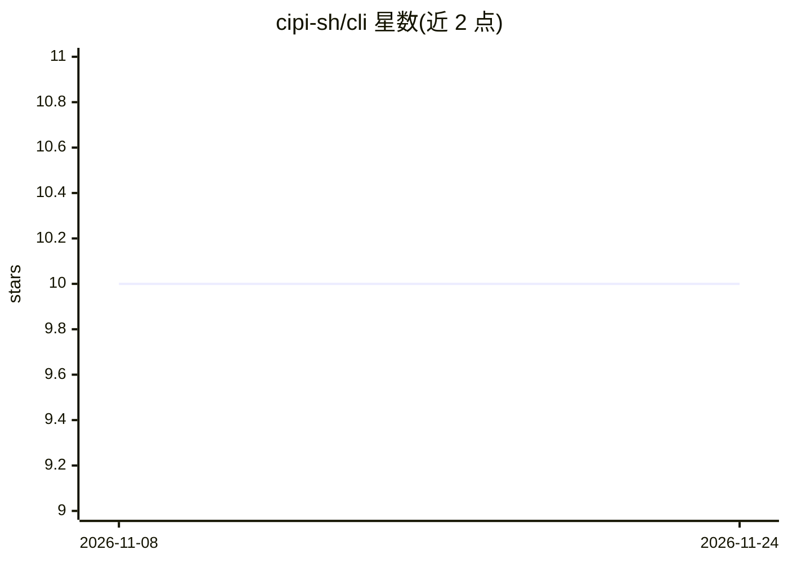

# cipi-sh/cli

⭐ 10 · Go · 推送 2026-11-23 · [GitHub](https://github.com/cipi-sh/cli) · [官网](https://cipi.sh/docs/cli-client) · 组织维护

**从终端管理 Cipi 服务器、应用、数据库与部署的 CLI 客户端**

Cipi 平台的命令行客户端：通过 API endpoint 加 token 以 profile 形式连接多台 Cipi 服务器，凭证本地存于 ~/.cipi/config.json（0600 权限）。命令覆盖应用增删改查与环境标签（production/staging）、触发部署与查看部署状态/历史、cipi.yml 的 plan/apply/auto、SSL 证书与 www/别名/重定向/反向代理管理、数据库引擎安装与备份恢复（含分块上传）、SMTP、健康检查与磁盘用量等。多步骤操作要求服务器端版本与 token ability 匹配（如 deploy-manage、yml-manage）。

## 筛选速览

| 维度 | 判定 | 备注 |
|---|---|---|
| AI 角色 | `ai-enhanced` | 去掉 AI 部分产品仍成立 |
| 许可风险 | `none` | — |
| 部署形态 | `desktop` | 安装包/桌面程序 |
| 模型依赖 | — | README 未给出锁定关系 |
| 硬件要求 | — | 无带数字的原话,不猜 |
| 安装摩擦 | `medium` | 含编译或系统依赖之一 |
| 成熟度 | — | 结构信号不足 |

## 能力要点

- 一个 profile 对应一台服务器，支持多服务器并存与默认配置切换
- cipi.yml 的 plan/apply/auto 工作流，apply 前预览变更与阻塞项
- 数据库恢复支持本地 .sql/.sql.gz 分块上传与失败重试
- apps create 打印 SSH、数据库凭证、deploy key 与 webhook

## 适用场景

- 从终端管理多台 Cipi 服务器上的应用与部署
- 用环境标签区分 staging 与 production 的配置文件
- 通过 cipi.yml 声明并应用应用的域名、PHP 设置、定时任务等状态

## 场景标签

 · 领域:开发运维/部署自动化

## 证据(README 行号)

> L3: Command-line interface for Cipi — manage servers, apps, databases, backups, SSL certificates, deployments, PHP and N

## 星数曲线

2026-11-08 10 → 2026-11-24 10（+0）

---
*卡片 v1 · prompt 1.4 · 生成 2026-11-19 · 置信度 low · 依据 README sha `59cd288621d8` · [字段定义](../../DATASET.md)*
