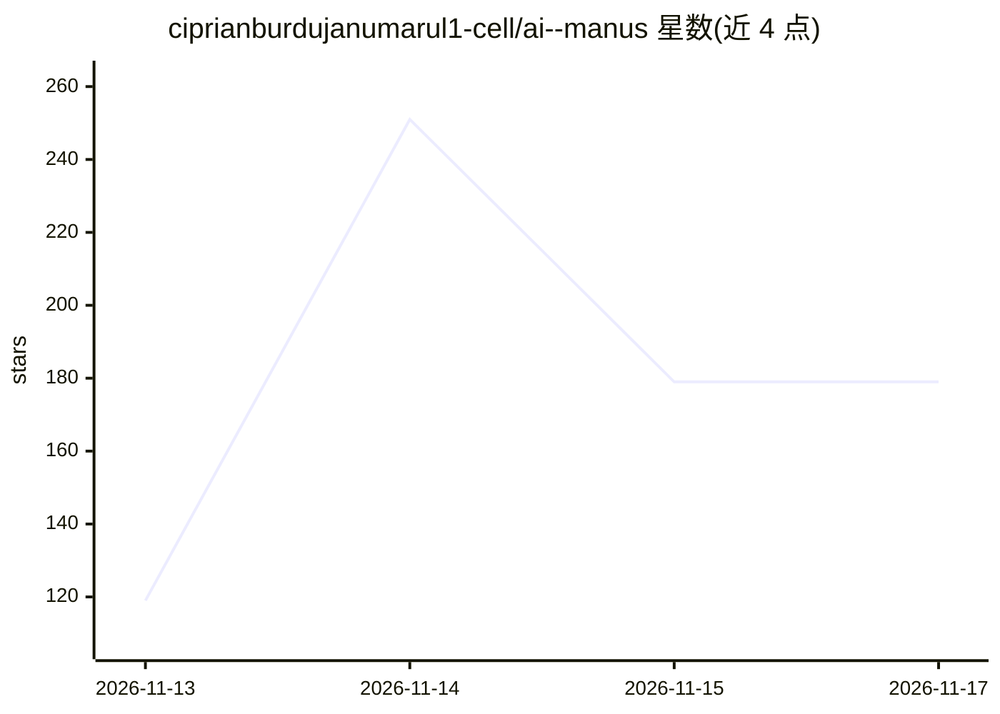

# ciprianburdujanumarul1-cell/ai--manus

⭐ 179 · Apache-2.0 · 推送 2026-11-14 · [GitHub](https://github.com/ciprianburdujanumarul1-cell/ai--manus) · 个人维护

**面向日常任务的自主 AI Agent：代跑代码与控制浏览器**

自称 Manus 的自主 AI Agent，定位为家庭、学习与轻量办公场景的个人助手：可自主编写并执行脚本、控制浏览器（导航网页、填写表单、采集信息），并以多步骤、低监督方式完成重复性任务。README 描述其具备跨会话记忆工作流模式的能力，并给出最低 4GB 内存、双核 CPU 的兼容性表格。但 README 未提供任何安装命令、源码结构或模型接入方式，仅含功能宣传与'下载/PROMO2026'字样，实际可用性无法从文档验证。

## 筛选速览

| 维度 | 判定 | 备注 |
|---|---|---|
| AI 角色 | `ai-native` | 本体是模型或模型工具 |
| 许可风险 | `permissive` | Apache-2.0 |
| 部署形态 | `None` |  |
| 模型依赖 | — | README 未给出锁定关系 |
| 硬件要求 | — | 无带数字的原话,不猜 |
| 安装摩擦 | `low` | 无编译、无系统依赖或容器化 |
| 成熟度 | — | 结构信号不足 |

## 能力要点

- 自主执行代码与控制浏览器完成多步骤任务
- 面向家庭、学习、轻量办公的小规模场景
- 声明跨会话记忆并复用工作流模式
- 给出最低 4GB RAM / 双核 CPU 兼容性表格

## 适用场景

- 让 agent 代为跑脚本和做网页信息采集
- 整理研究笔记、组织文件等日常杂务
- 远程支持中快速执行诊断步骤

## 场景标签

`AI 助手` `浏览器自动化` `编码 Agent` · 领域:效率与自动化

## 证据(README 行号)

> L18: Manus is an autonomous AI agent designed to run code and control a browser on your behalf. Instead of acting like a
> L10: - **Autonomous Code Execution:** Manus AI agent runs code on its own to complete tasks, so you can focus on decisio

## 星数曲线

2026-11-13 119 → 2026-11-17 179（+60）

---
*卡片 v1 · prompt 1.4 · 生成 2026-11-17 · 置信度 low · 依据 README sha `4347b4dd3fa7` · [字段定义](../../DATASET.md)*
