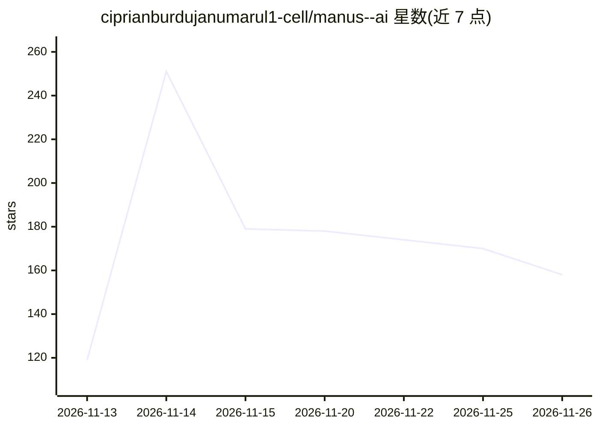

# ciprianburdujanumarul1-cell/manus--ai

⭐ 158 · Apache-2.0 · 推送 2026-11-14 · [GitHub](https://github.com/ciprianburdujanumarul1-cell/manus--ai) · 个人维护

**自主 AI Agent：代用户执行代码与控制浏览器完成多步任务**

README 描述的自主 AI 代理系统，核心能力为自动执行脚本、控制浏览器（导航网页、填表、抓取信息）并以最少监督完成多步任务，定位面向家庭、学习与轻量办公场景而非企业平台。README 给出兼容性表（最低双核 CPU、4 GB 内存）与六步上手流程（准备、配置、测试、细化、应用、维护）。仓库描述称其支持在沙盒环境中运行多种工具与操作，但 README 未给出安装命令、技术架构或模型接入方式等可验证细节。

## 筛选速览

| 维度 | 判定 | 备注 |
|---|---|---|
| AI 角色 | `ai-native` | 本体是模型或模型工具 |
| 许可风险 | `permissive` | Apache-2.0 |
| 部署形态 | `None` |  |
| 模型依赖 | — | README 未给出锁定关系 |
| 硬件要求 | — | 无带数字的原话,不猜 |
| 安装摩擦 | `low` | 无编译、无系统依赖或容器化 |
| 成熟度 | — | 结构信号不足 |

## 能力要点

- 自主执行代码与控制浏览器完成多步任务
- 跨会话记忆工作流模式并可重复应用
- 脚本与浏览器动作可在同一任务流中衔接
- 面向家庭、学习与轻量办公的小规模场景

## 适用场景

- 让学生整理研究笔记并运行快速计算
- 让代理代为浏览多页面收集数据并汇总
- 自动处理填表、检查页面等重复性小任务

## 场景标签

`工作流自动化` `浏览器自动化` `编码 Agent` · 领域:效率与自动化

## 证据(README 行号)

> L10: - **Autonomous Code Execution:** Manus AI agent runs code on its own to complete tasks, so you can focus on decisio
> L18: Manus is an autonomous AI agent designed to run code and control a browser on your behalf. Instead of acting like a

## 星数曲线

2026-11-13 119 → 2026-11-26 158（+39）

---
*卡片 v1 · prompt 1.4 · 生成 2026-11-17 · 置信度 low · 依据 README sha `4347b4dd3fa7` · [字段定义](../../DATASET.md)*
