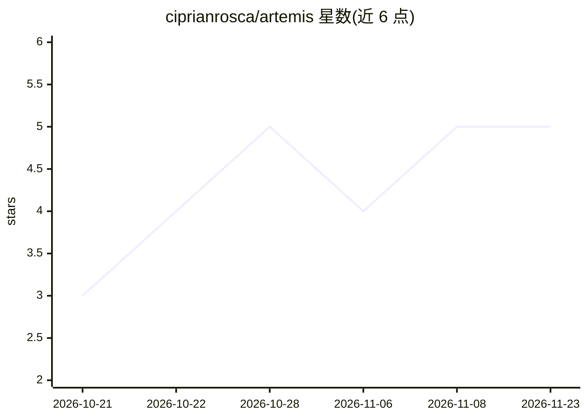

# ciprianrosca/artemis

⭐ 5 · Python · MIT · 推送 2026-11-20 · [GitHub](https://github.com/ciprianrosca/artemis) · 个人维护

**求职者的 AI 求职伙伴：找职位、诚实评分、定制简历**

面向求职者的 AI Agent：从公司自建招聘板（Greenhouse/Lever/Ashby 等）、HN Who is hiring、远程职位板与 LinkedIn 公开页读取职位，按 100 分制给出匹配分与 apply/stretch/skip 判定；基于带来源的 fact bank（主 CV）生成 ATS 安全简历、求职信、联系外联与面试准备，声明不编造事实、不代为投递。支持在 ChatGPT/Gemini/Claude app 免安装运行，或在 Claude Code/Codex CLI/Gemini CLI 中以完整工具集运行，需 Python 3.10+。个人数据存于本机 gitignored 目录或用户私有 git 仓库。

## 筛选速览

| 维度 | 判定 | 备注 |
|---|---|---|
| AI 角色 | `ai-native` | 本体是模型或模型工具 |
| 许可风险 | `permissive` | MIT |
| 部署形态 | `desktop` | 安装包/桌面程序 |
| 模型依赖 | locked-api |  |
| 硬件要求 | — | 无带数字的原话,不猜 |
| 安装摩擦 | `low` | 无编译、无系统依赖或容器化 |
| 成熟度 | — | 结构信号不足 |

## 能力要点

- fact bank 机制：每条简历内容均有来源，缺项时说明并建议诚实表述
- 100 分制职位匹配评分与 apply/stretch/skip 判定
- 直接读取公司招聘板、HN 与多个远程职位板
- 数据本地化：profile/applications/memory 目录 gitignored，可同步到私有 git 仓库

## 适用场景

- 按我的背景筛选值得投递的职位并给出匹配分
- 从主 CV 生成针对具体职位的定制简历与求职信
- 准备特定公司的面试并管理投递流水线
- 发现约 1,000 家科技公司的招聘页

## 场景标签

`AI 助手` · 领域:对话与助手

## 证据(README 行号)

> L3: Artemis finds roles worth your time, tells you honestly how well you fit each one, and builds the
> L7: It runs in **ChatGPT**, **Gemini** and the **Claude app** with no install, and in **Claude Code**,
> L30: - **Draft only.** It never applies, sends a message or logs in for you. You review everything

## 星数曲线

2026-10-21 3 → 2026-11-23 5（+2）

---
*卡片 v1 · prompt 1.4 · 生成 2026-11-21 · 置信度 high · 依据 README sha `a12ada6d98ca` · [字段定义](../../DATASET.md)*
