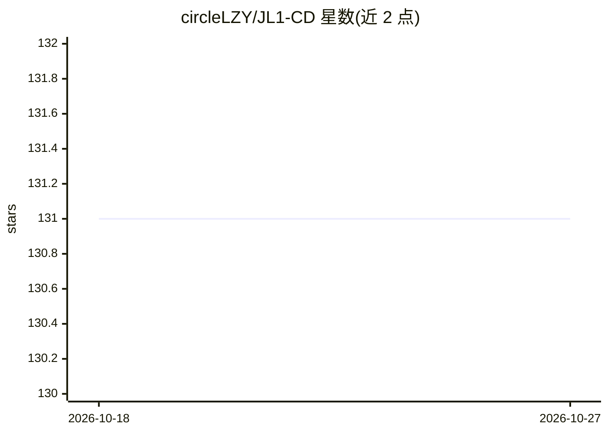

# circleLZY/JL1-CD

⭐ 131 · Python · 推送 2026-07-04 · [GitHub](https://github.com/circleLZY/JL1-CD) · 组织维护 · 中文 README

**遥感变化检测基准数据集与多教师知识蒸馏框架官方实现**

论文 JL1-CD 的官方代码库，基于 OpenCD 工具箱构建。发布 JL1-CD 遥感变化检测基准数据集，以及在其上构建的 JL1-CC（17,021 条经质量校验的变化描述）与 JL1-QA（20,060 条八类问答对）数据集，可通过 Google Drive、百度网盘和 Hugging Face 下载。代码实现 MTKD 多教师知识蒸馏框架，按小/中/大 CAR 分区训练教师模型再蒸馏学生模型，并支持 O-P 策略，提供 checkpoint 下载与训练/测试脚本。

## 筛选速览

| 维度 | 判定 | 备注 |
|---|---|---|
| AI 角色 | `ai-native` | 本体是模型或模型工具 |
| 许可风险 | `none` | — |
| 部署形态 | `None` |  |
| 模型依赖 | — | README 未给出锁定关系 |
| 硬件要求 | — | 无带数字的原话,不猜 |
| 安装摩擦 | `low` | 无编译、无系统依赖或容器化 |
| 成熟度 | — | 结构信号不足 |

## 能力要点

- JL1-CD 基准数据集及衍生 JL1-CC 变化描述、JL1-QA 问答数据集开源
- MTKD 多教师知识蒸馏框架，按小/中/大 CAR 分区训练教师模型
- 提供三步训练流程（原模型、教师模型、学生模型）与 O-P 策略测试脚本
- 模型 checkpoint 可从百度网盘与 Hugging Face 下载

## 适用场景

- 遥感变化检测模型的训练与基准评测
- 多教师知识蒸馏方法在变化检测任务上的复现
- 变化描述生成与遥感问答数据集的获取与使用

## 场景标签

`模型评测` · 领域:评测与运维

## 证据(README 行号)

> L3: Official implementation for the paper **JL1-CD: A New Benchmark for Remote Sensing Change Detection and a Robust Mul
> L11: ### JL1-CD

## 星数曲线

2026-10-18 131 → 2026-10-27 131（+0）

---
*卡片 v1 · prompt 1.4 · 生成 2026-10-22 · 置信度 high · 依据 README sha `3c39c2be178f` · [字段定义](../../DATASET.md)*
