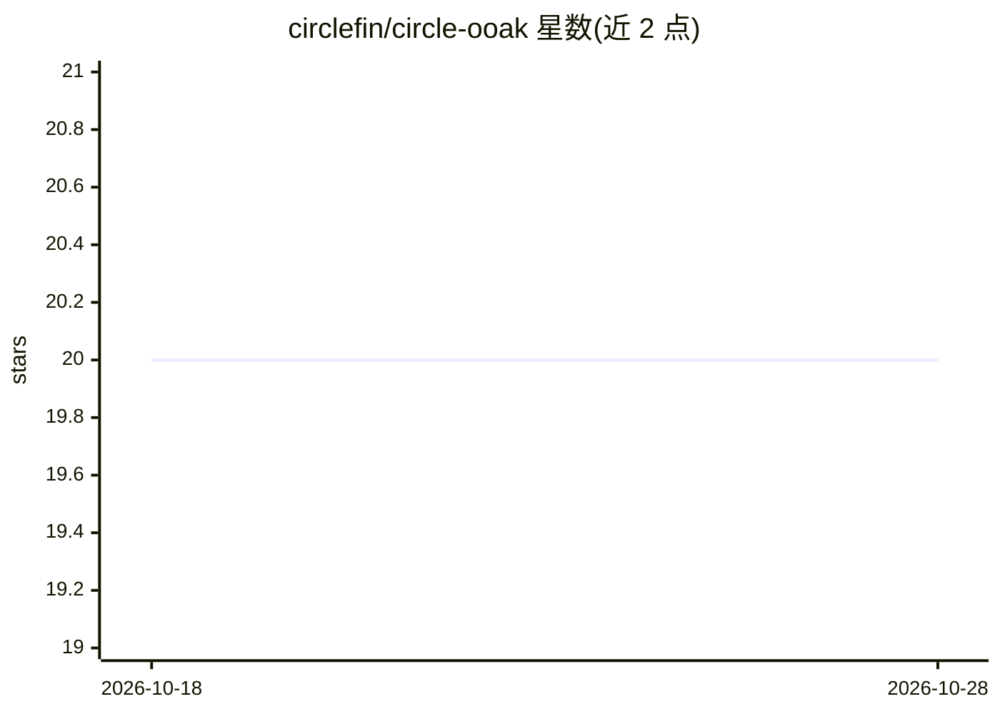

# circlefin/circle-ooak

⭐ 20 · Python · Apache-2.0 · 推送 2026-07-01 · [GitHub](https://github.com/circlefin/circle-ooak) · 组织维护

**扩展 OpenAI Agents SDK 的工具调用审批工作流框架**

Circle OOAK 是 OpenAI Agents SDK 的扩展包：提供 @agent_tool（支持对象实例方法）与 @secure_tool（支持前后钩子）装饰器，以及 InstanceAgent 子类。核心是 WorkflowManager 审批工作流：工具调用先返回意图 JSON，经用户重写的 get_approval() 批准获得 wfid 后按序执行，并在执行前校验调用与已批准计划一致。框架不包含生产审批 UI 或策略引擎，默认实现自动批准，仅用于演示；通过 pip 安装，需 OpenAI API key 运行 demo。

## 筛选速览

| 维度 | 判定 | 备注 |
|---|---|---|
| AI 角色 | `ai-ecosystem` | LLM/agent 周边工具 |
| 许可风险 | `permissive` | Apache-2.0 |
| 部署形态 | `library` | 以包/库形式分发 |
| 模型依赖 | — | README 未给出锁定关系 |
| 硬件要求 | — | 无带数字的原话,不猜 |
| 安装摩擦 | `low` | 无编译、无系统依赖或容器化 |
| 成熟度 | — | 结构信号不足 |

## 能力要点

- @agent_tool 支持对象实例方法，@secure_tool 支持前后钩子
- WorkflowManager 实现 intent→approval→enforce 的审批工作流（wfid 机制）
- 执行时校验工具名、参数与顺序是否匹配已批准计划
- 包含 start/complete/fail 三钩子的工作流状态机，默认实现自动批准

## 适用场景

- 为 agent 的敏感工具调用（如资金转账）加审批关卡
- 在 OpenAI Agents SDK 中使用面向对象的实例方法作为工具
- 构建带意图捕获与执行校验的多步 agent 工作流

## 场景标签

`Agent 框架` · 领域:Agent 开发

## 证据(README 行号)

> L6: This project creates an extension to the OpenAI Agents SDK.
> L15: This package includes a `WorkflowManager` that implements the abstract `SecureContext`,
> L37: OOAK is a framework: it handles intent capture, workflow state, and **enforcement** (each `@secure_tool` call must 

## 星数曲线

2026-10-18 20 → 2026-10-28 20（+0）

---
*卡片 v1 · prompt 1.4 · 生成 2026-10-28 · 置信度 high · 依据 README sha `e1508f578943` · [字段定义](../../DATASET.md)*
