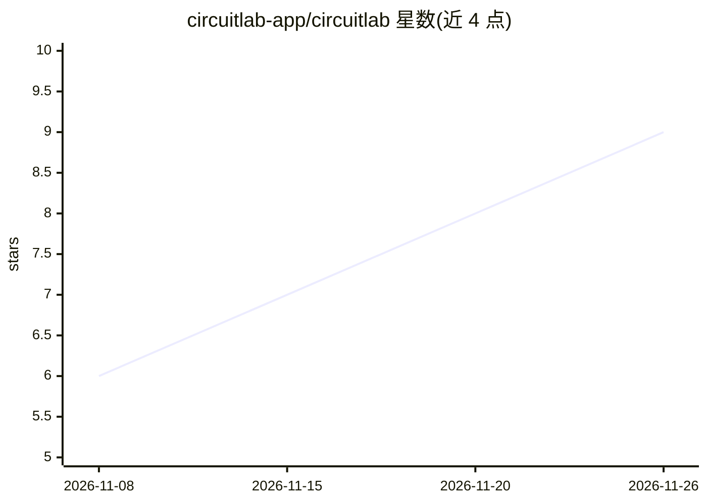

# circuitlab-app/circuitlab

⭐ 9 · TypeScript · MIT · 推送 2026-11-11 · [GitHub](https://github.com/circuitlab-app/circuitlab) · [官网](https://circuitlab.app/) · 组织维护

**儿童浏览器 3D 电路模拟器，AI 板可用自然语言控制电路**

面向儿童的 3D 电路模拟 Web 应用：拖放 111 种元件搭建电路并模拟电流、灯光、电机，提供 213 个示例项目、15 个任务挑战、69 种工具的图鉴课程，界面含英语/波斯语/阿拉伯语三语及 RTL 镜像。AI 板作为其中一种元件，通过本地 Ollama 运行的语言模型把自然语言请求转为各引脚的程序并显示引脚变化；Arduino/ESP32/树莓派等板卡会展示对应的 Arduino C++、MicroPython、AVR C 等真实代码。浏览器打开 demo 或 PWA 安装，本地开发需 Node.js 22.12+。MIT 许可，由 SBC 出品。

## 筛选速览

| 维度 | 判定 | 备注 |
|---|---|---|
| AI 角色 | `ai-enhanced` | 去掉 AI 部分产品仍成立 |
| 许可风险 | `permissive` | MIT |
| 部署形态 | `library` | 以包/库形式分发 |
| 模型依赖 | local-ok | 支持本地模型 |
| 硬件要求 | — | 无带数字的原话,不猜 |
| 安装摩擦 | `low` | 无编译、无系统依赖或容器化 |
| 成熟度 | — | 结构信号不足 |

## 能力要点

- 111 种元件、213 个示例项目的 3D 电路模拟
- AI 板通过本地 Ollama 运行模型，自然语言转引脚程序，无云端与账号
- 支持 Arduino/ESP32/树莓派等板卡并生成对应真实代码
- 英语/波斯语/阿拉伯语三语全量翻译与右到左镜像

## 适用场景

- 让孩子在浏览器里拖放元件搭电路并观察效果
- 用自然语言让 AI 板控制灯光、电机等元件
- 按任务挑战或示例项目自学电子知识

## 场景标签

 · 领域:教育/电子电路模拟

## 证据(README 行号)

> L5:  A 3D circuit simulator for kids that runs in the browser.
> L46:  A board you talk to. Wire lights, motors and buzzers to it, press Ask and type what they should do. It picks a pro
> L147: Circuit Lab is a product of **SBC** · sbc.om · released under the MIT License.

## 星数曲线

2026-11-08 6 → 2026-11-26 9（+3）

---
*卡片 v1 · prompt 1.4 · 生成 2026-11-20 · 置信度 high · 依据 README sha `03334a0147db` · [字段定义](../../DATASET.md)*
