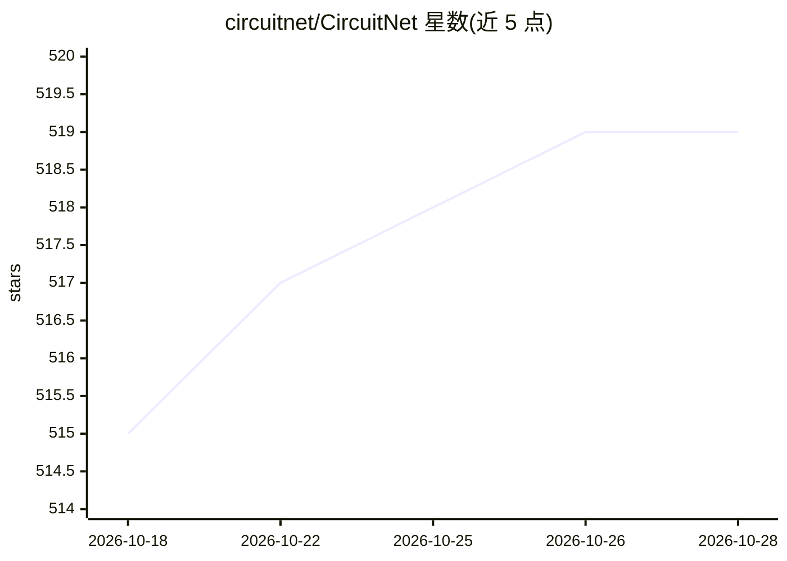

# circuitnet/CircuitNet

⭐ 519 · Python · BSD-3-Clause · 推送 2026-05-17 · [GitHub](https://github.com/circuitnet/CircuitNet) · [官网](https://circuitnet.github.io/) · 组织维护 · 中文 README

**面向 EDA 机器学习的开源数据集与基准代码库**

CircuitNet 提供电子设计自动化（EDA）领域的开源数据集及配套训练/测试代码，覆盖拥塞预测、DRC 违例预测、IR drop 预测与网络延迟预测四类任务。数据集含 CircuitNet-N28（Google Drive/百度网盘分发）与 N14、N45 版本（托管于 Hugging Face）。代码基于 PyTorch，实验环境为 Python 3.9 与 PyTorch 1.11，网络延迟任务额外需要 DGL。以 BSD 3-Clause 许可发布，附 TCAD 与 ICLR 论文引用。

## 筛选速览

| 维度 | 判定 | 备注 |
|---|---|---|
| AI 角色 | `ai-knowledge` | 知识聚合/清单类 |
| 许可风险 | `permissive` | BSD-3-Clause |
| 部署形态 | `library` | 以包/库形式分发 |
| 模型依赖 | — | README 未给出锁定关系 |
| 硬件要求 | — | 无带数字的原话,不猜 |
| 安装摩擦 | `low` | 无编译、无系统依赖或容器化 |
| 成熟度 | — | 结构信号不足 |

## 能力要点

- 拥塞/DRC/IR drop/网络延迟四类任务的训练与测试脚本
- CircuitNet-N28/N14/N45 三个工艺版本的数据集
- 网络延迟任务提供图构建脚本（依赖 DGL）

## 适用场景

- 复现 EDA 机器学习已有方法与基准
- 训练芯片布线拥塞或 IR drop 预测模型
- 获取多工艺节点的 EDA 数据集做研究

## 场景标签

`模型评测` · 领域:评测与运维

## 证据(README 行号)

> L1: # CircuitNet: An Open-Source Dataset for Machine Learning Applications in Electronic Design Automation (EDA)
> L5: This repository is intended to hosts codes and demos for CircuitNet, we hope this codebase would be helpful for user

## 星数曲线

2026-10-18 515 → 2026-10-28 519（+4）

---
*卡片 v1 · prompt 1.4 · 生成 2026-10-21 · 置信度 high · 依据 README sha `939a5f1a3fa4` · [字段定义](../../DATASET.md)*
