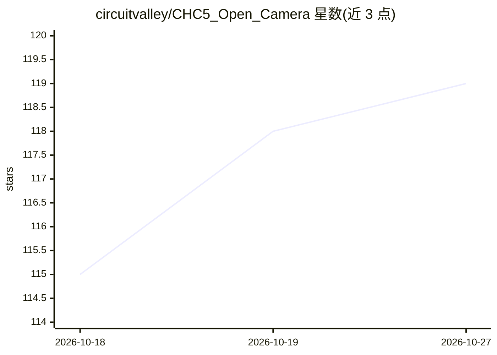

# circuitvalley/CHC5_Open_Camera

⭐ 119 · C · 推送 2026-10-20 · [GitHub](https://github.com/circuitvalley/CHC5_Open_Camera) · [官网](https://www.circuitvalley.com) · 个人维护

**开源机器视觉相机：FPGA ISP、可换镜头、多 Sony 传感器**

CircuitValley 开发的开源机器视觉相机系统，采用 FPGA 实现 ISP，处理速率 600 Mpixel/秒，支持多种 Sony/OmniVision CMOS 传感器（滚动快门与全局快门），最高约 128 Mpixel 分辨率。提供可换镜头卡口（C/CS、Canon RF、Sony E 等）、USB3（UVC/USB3 Vision）、以太网（GigE Vision）、HDMI 三接口同时流媒体输出，以及隔离 Aux I/O 与多相机同步。README 未给出软件安装或源码构建说明，内容以硬件规格与系列视频为主，许可证为 CC BY-NC-ND 4.0。

## 筛选速览

| 维度 | 判定 | 备注 |
|---|---|---|
| AI 角色 | `ai-enhanced` | 去掉 AI 部分产品仍成立 |
| 许可风险 | `none` | — |
| 部署形态 | `None` |  |
| 模型依赖 | — | README 未给出锁定关系 |
| 硬件要求 | — | 无带数字的原话,不猜 |
| 安装摩擦 | `low` | 无编译、无系统依赖或容器化 |
| 成熟度 | — | 结构信号不足 |

## 能力要点

- FPGA ISP，600 Mpixel/秒处理速率，帧率几乎无上限
- 支持 MIPI D-PHY/LVDS 等接口传感器，最高 8 通道 10 Gbps
- USB3/以太网/HDMI 三接口同时流输出
- 可换镜头卡口与用户可更换滤镜（内 IR-cut、外 43mm）

## 适用场景

- 搭建需要全局快门或高动态范围的机器视觉采集系统
- 多相机同步的工业或科研成像
- 需要 UVC/GigE Vision 标准协议接入视觉软件的相机选型

## 场景标签

 · 领域:机器视觉/硬件

## 证据(README 行号)

> L1: # CHC5 Open Camera System
> L111: Shield: [![CC BY-NC-ND 4.0][cc-by-nc-nd-shield]][cc-by-nc-nd]

## 星数曲线

2026-10-18 115 → 2026-10-27 119（+4）

---
*卡片 v1 · prompt 1.4 · 生成 2026-10-23 · 置信度 low · 依据 README sha `b3752cc7872d` · [字段定义](../../DATASET.md)*
