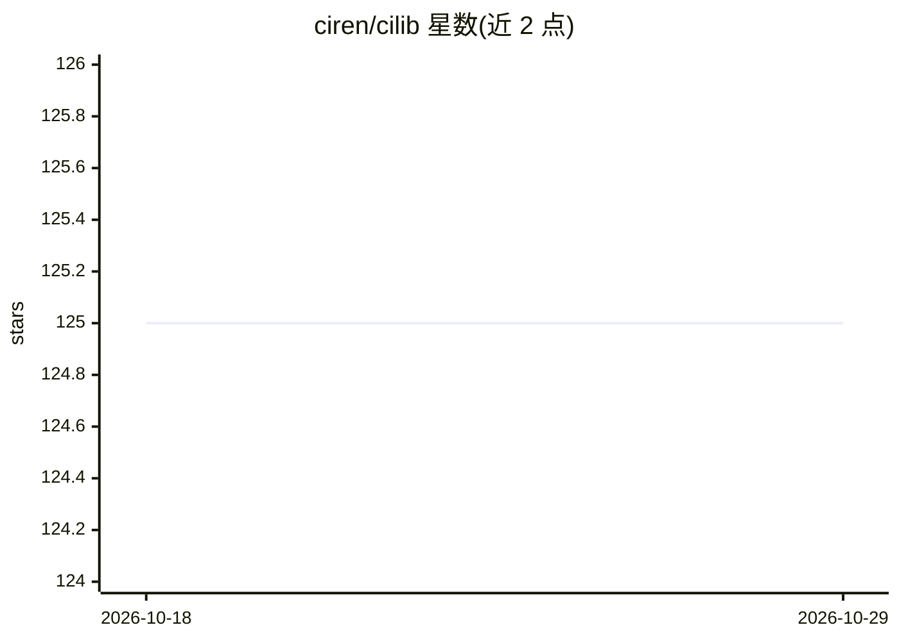

# ciren/cilib

⭐ 125 · Scala · Apache-2.0 · 推送 2026-04-30 · [GitHub](https://github.com/ciren/cilib) · [官网](https://cilib.net) · 个人维护

**Scala 类型安全的纯函数式计算智能算法库**

CIlib 是用 Scala 编写的计算智能算法库，面向研究者和使用者。提供类型安全设计以减少运行时错误与无效数据表示，支持仿真的可复现以便验证与复用已发表结果，并通过 Functor、Monad 等类型类实现组合式定义算法。项目自称是库而非框架，仅由少量抽象构成。发布于 Maven Central，附带 scaladoc、示例代码与 Discord/GitHub discussions 支持渠道。

## 筛选速览

| 维度 | 判定 | 备注 |
|---|---|---|
| AI 角色 | `ai-native` | 本体是模型或模型工具 |
| 许可风险 | `permissive` | Apache-2.0 |
| 部署形态 | `None` |  |
| 模型依赖 | — | README 未给出锁定关系 |
| 硬件要求 | — | 无带数字的原话,不猜 |
| 安装摩擦 | `low` | 无编译、无系统依赖或容器化 |
| 成熟度 | — | 结构信号不足 |

## 能力要点

- 类型安全设计，减少运行时错误与无效数据表示
- 支持仿真的精确复现，便于验证已发表结果
- 基于 Functor/Monad 等类型类的组合式抽象

## 适用场景

- 研究者复现与验证计算智能仿真结果
- 以组合方式定义计算智能算法
- 在 Scala 项目中通过 Maven Central 引用算法库

## 场景标签

 · 领域:机器学习/优化算法

## 证据(README 行号)

> L8: CIlib is a library of various computational intelligence
> L9: algorithms. The goal of the project is to create a library that can be used
> L15:  * Allow for the perfect reproduction of simulations, enabling researchers

## 星数曲线

2026-10-18 125 → 2026-10-29 125（+0）

---
*卡片 v1 · prompt 1.4 · 生成 2026-10-23 · 置信度 mid · 依据 README sha `c039d6fbdf68` · [字段定义](../../DATASET.md)*
