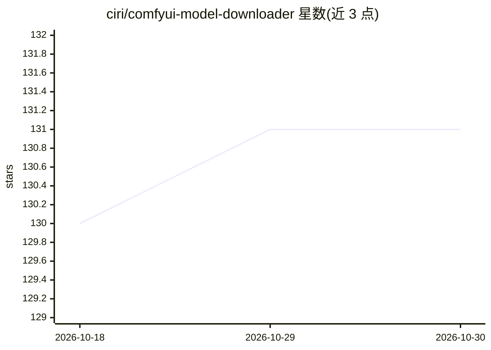

# ciri/comfyui-model-downloader

⭐ 131 · Python · AGPL-3.0 · 推送 2026-07-14 · [GitHub](https://github.com/ciri/comfyui-model-downloader) · 个人维护

**ComfyUI 自定义节点：在画布内从 Hugging Face/CivitAI 下载模型**

ComfyUI 的模型下载自定义节点，提供 HF Downloader 与 CivitAI Downloader 两个节点，分别按 repo_id/filename 和 model_id/version_id 下载模型到 ComfyUI 模型目录，支持 HF token 与 CivitAI API key 访问受限仓库。另有实验性 Auto Model Finder，扫描工作流缺失的已知模型文件并匹配 Hugging Face 仓库。下载目的地遵循 ComfyUI 的 extra_model_paths.yaml 配置。面向受限网络或复杂环境下的 ComfyUI 用户，通过 ComfyUI Manager 或 git clone 安装，需 Python 3.10+。

## 筛选速览

| 维度 | 判定 | 备注 |
|---|---|---|
| AI 角色 | `ai-ecosystem` | LLM/agent 周边工具 |
| 许可风险 | `viral` | AGPL-3.0 |
| 部署形态 | `library` | 以包/库形式分发 |
| 模型依赖 | — | README 未给出锁定关系 |
| 硬件要求 | — | 无带数字的原话,不猜 |
| 安装摩擦 | `low` | 无编译、无系统依赖或容器化 |
| 成熟度 | `idea` | |

## 能力要点

- HF Downloader 按 repo_id/filename 下载，支持访问令牌
- CivitAI Downloader 按 model_id/version_id 下载，支持 API key
- 实验性 Auto Model Finder 扫描工作流缺失模型并匹配 HF 仓库
- 下载目录遵循 extra_model_paths.yaml 配置

## 适用场景

- 在 ComfyUI 工作流中直接下载缺失的模型文件
- 受限网络环境下获取 Hugging Face / CivitAI 模型
- 自动检测工作流缺失模型并补全下载

## 场景标签

 · 领域:AI 图像生成/工作流工具

## 证据(README 行号)

> L7:  ComfyUI custom node
> L15: This project provides a model downloader node for ComfyUI, designed to simplify the process of downloading and mana
> L19: - **Repositories**: Currently supports hugging face and CivitAI.

## 星数曲线

2026-10-18 130 → 2026-10-30 131（+1）

---
*卡片 v1 · prompt 1.4 · 生成 2026-10-22 · 置信度 mid · 依据 README sha `677aa783aea4` · [字段定义](../../DATASET.md)*
