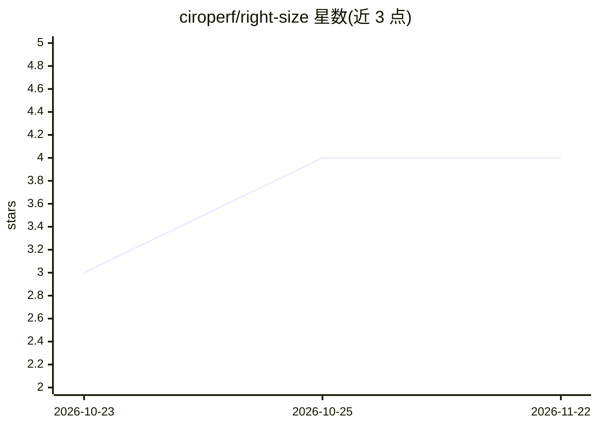

# ciroperf/right-size

⭐ 4 · Python · MIT · 推送 2026-11-09 · [GitHub](https://github.com/ciroperf/right-size) · 个人维护

**为编码 Agent 任务选模型与推理档位的技能和路由器**

面向 Claude Code、Codex 等编码 Agent 的插件式工具：提供四个 Agent Skills（消费审计、默认档位设置、路由器、会话内顾问），按任务风险与测试覆盖给出起始模型和 effort 档位，检查失败后逐级升级而非全程用最高档。路由器模式在 headless 下按阶梯启动会话，运行空 diff 检查、测试命令与上一档 reviewer 审查。仓库内附带基准测试（含变差案例）。通过插件市场或 npx 安装，支持多 harness 映射。

## 筛选速览

| 维度 | 判定 | 备注 |
|---|---|---|
| AI 角色 | `ai-ecosystem` | LLM/agent 周边工具 |
| 许可风险 | `permissive` | MIT |
| 部署形态 | `library` | 以包/库形式分发 |
| 模型依赖 | locked-api |  |
| 硬件要求 | — | 无带数字的原话,不猜 |
| 安装摩擦 | `low` | 无编译、无系统依赖或容器化 |
| 成熟度 | — | 结构信号不足 |

## 能力要点

- 四个技能：/right-size-audit 消费审计、/right-size-defaults 默认档位、路由器 route.py、会话内顾问
- 基于风险的分档：auth/支付/迁移/公共 API 进入最高档，与 diff 大小无关
- 升级基于证据：可验证失败升一档、推理失败升两档，默认最多三步
- 多 harness 支持：Claude Code 与 Codex 原生配置，Antigravity/Cursor/Copilot 仅建议映射

## 适用场景

- 降低编码 Agent 会话的 token 消耗与成本
- 决定任务该 inline 做还是委派给 subagent
- 审计近 30 天各模型、token 类型与 subagent 的花费分布
- 为团队项目设定统一的默认模型与 effort 档位

## 场景标签

`模型评测` · 领域:评测与运维

## 证据(README 行号)

> L3: **Agent Skills and a small router that give every coding task the compute it deserves: the model and effort to start
> L57: - 🔌 **Multi-harness.** One decision, translated into each agent's native config: Claude Code and Codex, with advice
> L44: - 🧭 **Router mode** (`route.py`) starts a session on the cheapest tier that fits, checks every attempt (did anythin

## 星数曲线

2026-10-23 3 → 2026-11-22 4（+1）

---
*卡片 v1 · prompt 1.4 · 生成 2026-11-21 · 置信度 high · 依据 README sha `944583f3d8cd` · [字段定义](../../DATASET.md)*
