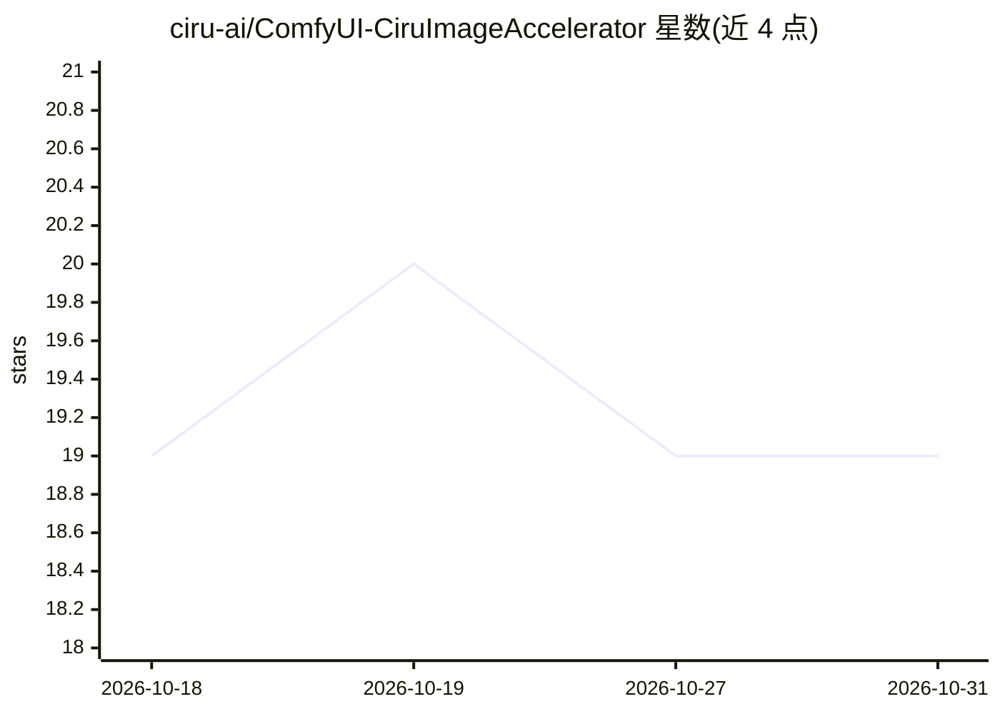

# ciru-ai/ComfyUI-CiruImageAccelerator

⭐ 19 · Python · GPL-3.0 · 推送 2026-09-24 · [GitHub](https://github.com/ciru-ai/ComfyUI-CiruImageAccelerator) · [官网](https://registry.comfy.org/publishers/ciru/nodes/ciru-image-accelerator) · 组织维护

**AMD Strix Halo 上加速 Qwen Image 2.1 出图的 ComfyUI 节点**

面向 ComfyUI 的单个 MODEL→MODEL 加速节点，作用于 Qwen Image 2.1 文生图与图像编辑：通过残差预测减少完整去噪评估次数（默认 12/30，其余步用预测输出），并在 AMD Strix Halo（gfx1151）上对 2048 方图启用打包 BF16 attention 内核，其他硬件走 ComfyUI 原生 attention。节点本身不含模型权重，需用户自行安装 Qwen Image 2.1 的 INT8 ConvRot 去噪器、编码器与 BF16 VAE；可选 2048 内核需 Triton，缺失时自动回退。编辑预测为实验性且需显式开启；仅验证了 Radeon 8060S、Euler/simple、CFG 1、batch 1，CUDA 与其他 GPU 未验证。

## 筛选速览

| 维度 | 判定 | 备注 |
|---|---|---|
| AI 角色 | `ai-ecosystem` | LLM/agent 周边工具 |
| 许可风险 | `dual` | GPL-3.0 |
| 部署形态 | `library` | 以包/库形式分发 |
| 模型依赖 | — | README 未给出锁定关系 |
| 硬件要求 | — | 无带数字的原话,不猜 |
| 安装摩擦 | `medium` | 含编译或系统依赖之一 |
| 成熟度 | `idea` | |

## 能力要点

- 默认 12/30 次完整评估，其余采样步使用预测的去噪输出
- gfx1151 上 2048 方图的打包 BF16 attention 内核（auto 模式自动选择）
- 不重新分发模型权重，复用 ComfyUI 已装的 Qwen Image 2.1 组件
- 提供 doctor.py 环境自检脚本与 GUI/API 示例工作流

## 适用场景

- 在 Strix Halo（Radeon 8060S）上缩短 Qwen Image 2.1 出图时间
- 在 ComfyUI 中对文生图和图像编辑统一使用同一加速节点
- 用 doctor.py 排查 ROCm/Triton 环境问题

## 场景标签

`图像生成` · 领域:内容生成

## 证据(README 行号)

> L3: A single `MODEL` → `MODEL` node for Qwen Image 2.1 text-to-image and image editing. Connect **UNETLoader → QwenImage
> L5: The node contains no model weights. It uses the Qwen Image 2.1 model, text encoder and VAE already installed in Comf

## 星数曲线

2026-10-18 19 → 2026-10-31 19（+0）

---
*卡片 v1 · prompt 1.4 · 生成 2026-10-28 · 置信度 mid · 依据 README sha `431821103f6f` · [字段定义](../../DATASET.md)*
