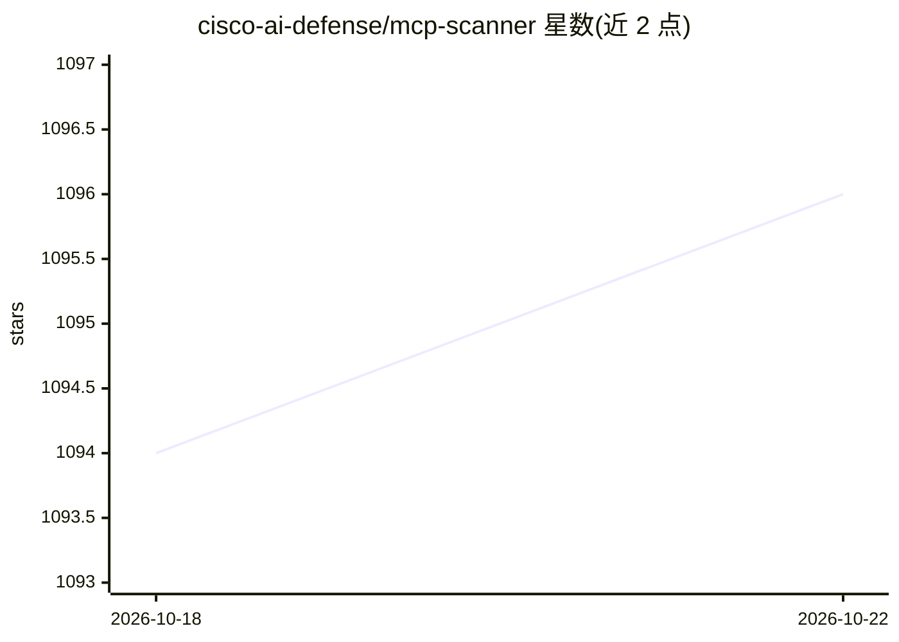

# cisco-ai-defense/mcp-scanner

⭐ 1,096 · Python · Apache-2.0 · 推送 2026-10-20 · [GitHub](https://github.com/cisco-ai-defense/mcp-scanner) · [官网](https://blogs.cisco.com/ai/securing-the-ai-agent-supply-chain-with-ciscos-open-source-mcp-scanner) · 组织维护

**扫描 MCP 服务器与工具安全风险的 Python 安全工具**

Cisco AI Defense 维护的 Python CLI/SDK/REST API 工具，用于扫描 MCP（Model Context Protocol）服务器、工具、提示、资源与服务器指令的安全风险。组合三种扫描引擎（YARA 规则、LLM 分析、Cisco AI Defense inspect API，可单独或联合使用），另提供 pip-audit 依赖漏洞扫描、VirusTotal 二进制恶意软件检测、Docker 沙箱内的 PyPI/npm 包行为分析，以及多语言行为代码扫描（10 种语言）。支持离线静态扫描用于 CI/CD。Cisco API key、LLM key、VirusTotal key 均为可选。

## 筛选速览

| 维度 | 判定 | 备注 |
|---|---|---|
| AI 角色 | `ai-ecosystem` | LLM/agent 周边工具 |
| 许可风险 | `permissive` | Apache-2.0 |
| 部署形态 | `desktop` | 安装包/桌面程序 |
| 模型依赖 | local-ok | 支持本地模型 |
| 硬件要求 | — | 无带数字的原话,不猜 |
| 安装摩擦 | `low` | 无编译、无系统依赖或容器化 |
| 成熟度 | — | 结构信号不足 |

## 能力要点

- 三引擎扫描：YARA、LLM 分析、Cisco AI Defense inspect API 可独立或联合运行
- pip-audit 检测 Python 依赖已知漏洞（CVE/PYSEC/GHSA）
- Docker 沙箱内下载并扫描 PyPI/npm 包，代码不执行
- 支持本地 LLM 端点（Ollama/vLLM/LocalAI）与离线 JSON 静态扫描

## 适用场景

- 接入 MCP 服务器前扫描工具是否存在投毒或提示注入
- CI/CD 流水线中离线扫描预生成的 MCP 配置
- 审计本机 MCP 客户端（Cursor/Windsurf/Claude/VS Code）配置的安全风险

## 场景标签

`网络安全` · 领域:学习与行业

## 证据(README 行号)

> L10: A Python tool for scanning MCP (Model Context Protocol) servers and tools for potential security findings. The MCP 
> L14: The MCP Scanner provides a comprehensive solution for scanning MCP servers and tools for security findings. It leve

## 星数曲线

2026-10-18 1,094 → 2026-10-22 1,096（+2）

---
*卡片 v1 · prompt 1.4 · 生成 2026-10-21 · 置信度 high · 依据 README sha `b59c40e7b264` · [字段定义](../../DATASET.md)*
