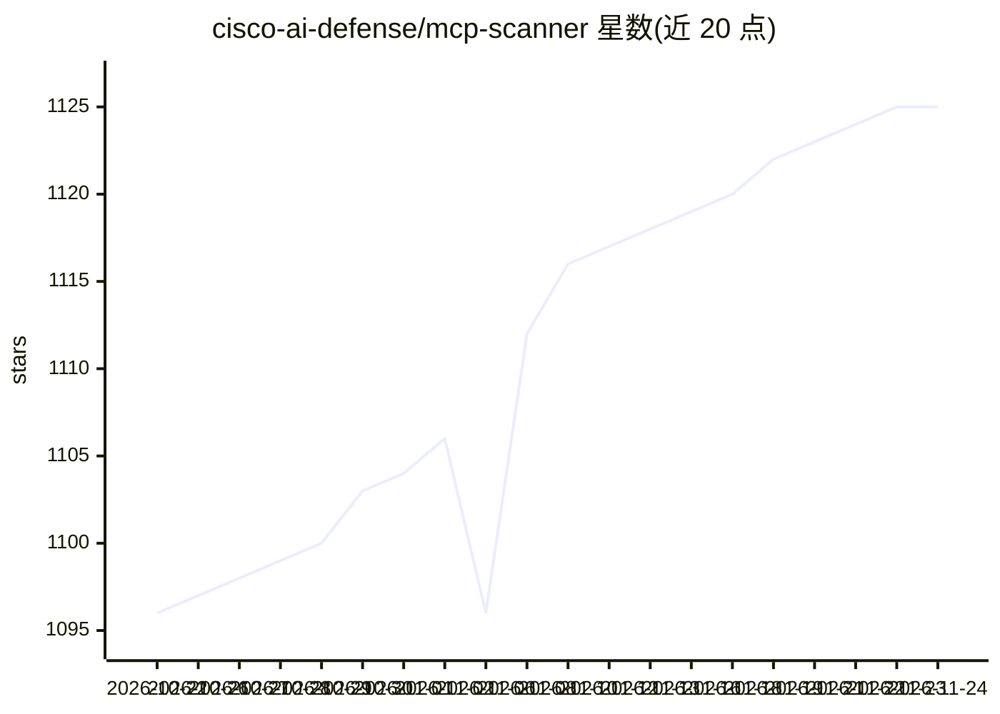

# cisco-ai-defense/mcp-scanner

⭐ 1,125 · Python · Apache-2.0 · 推送 2026-11-19 · [GitHub](https://github.com/cisco-ai-defense/mcp-scanner) · [官网](https://blogs.cisco.com/ai/securing-the-ai-agent-supply-chain-with-ciscos-open-source-mcp-scanner) · 组织维护

**扫描 MCP 服务器与工具的安全隐患，供 MCP 使用者排查威胁**

Cisco AI Defense 开源的 Python 工具，通过三套引擎（YARA 规则、LLM 分析、Cisco AI Defense inspect API）扫描 MCP 服务器的工具、提示词、资源与服务器指令，检测恶意 MCP 工具；另支持 pip-audit 漏洞扫描、源码行为分析、VirusTotal 二进制查毒、Docker 沙箱内的 PyPI/npm 包行为扫描及离线静态 JSON 扫描。可作为 CLI 或 REST API 服务运行，三引擎可组合或独立使用，AI Defense API Key、LLM Key、VirusTotal Key 均为可选项。

## 筛选速览

| 维度 | 判定 | 备注 |
|---|---|---|
| AI 角色 | `ai-ecosystem` | LLM/agent 周边工具 |
| 许可风险 | `permissive` | Apache-2.0 |
| 部署形态 | `desktop` | 安装包/桌面程序 |
| 模型依赖 | local-ok | 支持本地模型 |
| 硬件要求 | — | 无带数字的原话,不猜 |
| 安装摩擦 | `low` | 无编译、无系统依赖或容器化 |
| 成熟度 | — | 结构信号不足 |

## 能力要点

- 三引擎扫描：YARA 规则、LLM 分析、Cisco AI Defense inspect API，可组合或独立使用
- 支持扫描 MCP 工具、提示词、资源、服务器指令及源码行为
- Docker 沙箱内扫描 PyPI/npm 包，VirusTotal 哈希查毒
- MCP 协议版本自动协商，兼容新旧服务器（HTTP/SSE 与 stdio）

## 适用场景

- 接入 MCP 服务器前扫描其工具是否存在安全隐患
- 在 CI/CD 或隔离环境中离线扫描 MCP 配置 JSON
- 审计本机 Windsurf/Cursor/Claude/VS Code 等客户端配置中的 MCP 服务器
- 下载 PyPI/npm 包前在沙箱中做行为安全分析

## 场景标签

`网络安全` · 领域:学习与行业

## 证据(README 行号)

> L10: A Python tool for scanning MCP (Model Context Protocol) servers and tools for potential security findings. The MCP 
> L14: The MCP Scanner provides a comprehensive solution for scanning MCP servers and tools for security findings. It leve
> L22: - **Multiple Modes:** Run scanner as a stand-alone CLI tool or REST API server

## 星数曲线

2026-10-22 1,096 → 2026-11-24 1,125（+29）

---
*卡片 v1 · prompt 1.4 · 生成 2026-11-24 · 置信度 high · 依据 README sha `2c15f5568dab` · [字段定义](../../DATASET.md)*
