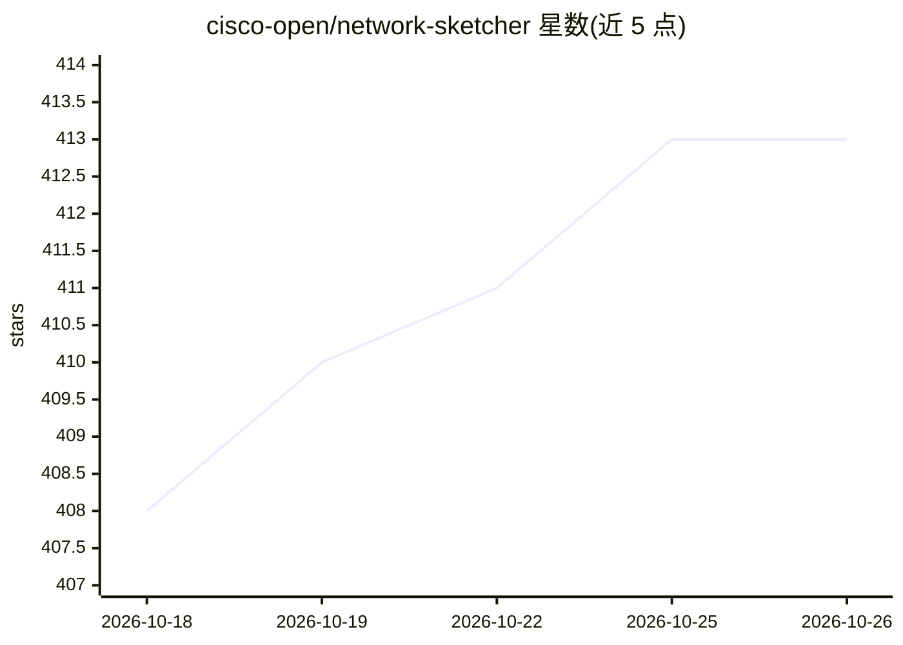

# cisco-open/network-sketcher

⭐ 413 · Python · Apache-2.0 · 推送 2026-10-05 · [GitHub](https://github.com/cisco-open/network-sketcher) · [官网](https://github.com/cisco-open/network-sketcher) · 组织维护

**面向 LLM 客户端的网络设计与拓扑图生成工具（MCP/Web/桌面三版本）**

Cisco 开源的网络设计与制图工具，含三个版本：Local MCP 版将引擎封装为 Model Context Protocol 服务器，让 Cursor、Claude Code 等 LLM 客户端通过 Tool 调用直接执行网络设计 CLI，经 stdio 本地运行，生成 L1/L2/L3 拓扑图（SVG/PPTX）、设备表（Excel/HTML）与 AI Context 文件；Online 版为浏览器 Web 服务（Flask）；Offline 版为 tkinter 桌面 GUI + CLI，不依赖 AI。另提供独立的 Cisco Extension 转换器仓库，可将 ACI、Meraki、NetBox 等平台导出转为 CLI 命令脚本。Local MCP 版限单用户、仅 stdio，推荐 Claude Opus 4.7 及以上模型。

## 筛选速览

| 维度 | 判定 | 备注 |
|---|---|---|
| AI 角色 | `ai-ecosystem` | LLM/agent 周边工具 |
| 许可风险 | `permissive` | Apache-2.0 |
| 部署形态 | `desktop` | 安装包/桌面程序 |
| 模型依赖 | — | README 未给出锁定关系 |
| 硬件要求 | — | 无带数字的原话,不猜 |
| 安装摩擦 | `low` | 无编译、无系统依赖或容器化 |
| 成熟度 | — | 结构信号不足 |

## 能力要点

- Local MCP 版以 MCP Tool 调用驱动网络设计 CLI，stdio 本地运行
- 生成 L1/L2/L3 拓扑图（SVG/PPTX/draw.io）与设备表、AI Context 文件
- Cisco Extension 覆盖 ACI、Catalyst Center、Meraki、NetBox 等 10 类转换器
- Online 版会话结束后自动删除上传与生成文件，服务器不留存数据

## 适用场景

- 在 Cursor/Claude Code 中通过对话让 AI 生成多站点 WAN/园区网设计
- 从 ACI、Meraki、NetBox 等现网导出转换为网络设计草稿
- 导出 PowerPoint 拓扑图与 Excel 设备配置数据用于文档交付

## 场景标签

 · 领域:网络工程/自动化

## 证据(README 行号)

> L13: **Network Sketcher is an AI-native network design and diagramming tool. It generates L1/L2/L3 topology diagrams, de
> L15: For MCP users, **Network Sketcher Local MCP** lets LLM clients such as Cursor and Claude Code design Cisco-style ne
> L131: Network Sketcher Local MCP is the third edition of Network Sketcher. It wraps `network-sketcher_online/ns_engine/`

## 星数曲线

2026-10-18 408 → 2026-10-26 413（+5）

---
*卡片 v1 · prompt 1.4 · 生成 2026-10-21 · 置信度 mid · 依据 README sha `605a6ff56a69` · [字段定义](../../DATASET.md)*
