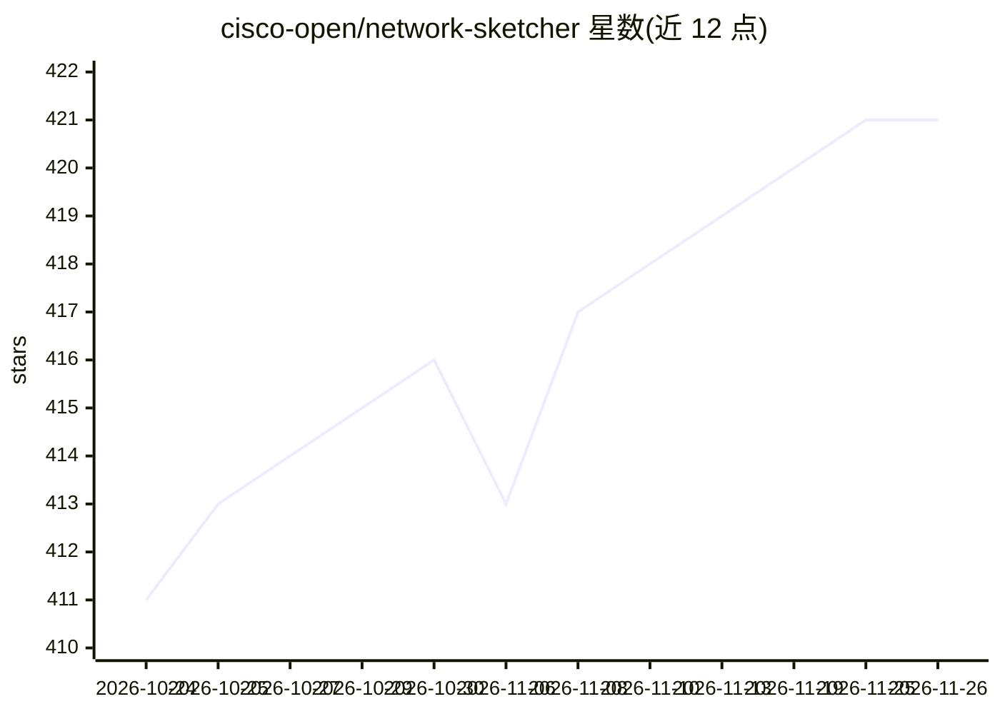

# cisco-open/network-sketcher

⭐ 421 · Python · Apache-2.0 · 推送 2026-11-25 · [GitHub](https://github.com/cisco-open/network-sketcher) · [官网](https://github.com/cisco-open/network-sketcher) · 组织维护

**让 LLM 客户端驱动网络设计与拓扑图输出的工具**

提供三种版本的网络设计工具：Local MCP 版将引擎封装为 Model Context Protocol 服务器，由 Cursor、Claude Code 等 LLM 客户端通过工具调用直接执行 CLI；Online 版为浏览器 Web 服务；Offline 版为桌面 GUI + CLI。从结构化网络数据生成 L1/L2/L3 拓扑图、设备表、SVG/PowerPoint 文件与 AI Context 文件。Cisco Extension 转换器可将 ACI、Meraki、NetBox 等平台导出转为 CLI 命令。MCP 版仅支持 stdio 传输、单用户本地运行，大网络出图耗时较长。

## 筛选速览

| 维度 | 判定 | 备注 |
|---|---|---|
| AI 角色 | `ai-enhanced` | 去掉 AI 部分产品仍成立 |
| 许可风险 | `permissive` | Apache-2.0 |
| 部署形态 | `desktop` | 安装包/桌面程序 |
| 模型依赖 | — | README 未给出锁定关系 |
| 硬件要求 | — | 无带数字的原话,不猜 |
| 安装摩擦 | `low` | 无编译、无系统依赖或容器化 |
| 成熟度 | `idea` | |

## 能力要点

- Local MCP 版以 stdio 方式暴露 MCP 服务器，LLM 客户端直接调用工具完成网络设计
- 生成 L1/L2/L3 拓扑图、HTML 设备表、SVG/PowerPoint 图与 AI Context 文件
- Cisco Extension 转换器支持 ACI、Catalyst Center、Meraki、NetBox 等平台导入
- Online 版输出 SVG 与 PPTX 双模式，会话结束自动删除服务器端文件

## 适用场景

- 通过对话让 AI agent 搭建多站点 WAN 或园区 LAN 设计
- 从 Cisco 平台导出文件生成网络草图与设备表
- 为另一次 LLM 审查或扩展设计生成 AI Context 文件
- 离线环境下用 GUI/CLI 生成 PowerPoint 拓扑图

## 场景标签

 · 领域:网络自动化/网络设计工具

## 证据(README 行号)

> L83: - **Network Sketcher Local MCP** — **AI-native MCP server for LLM clients (Cursor, Claude Code, etc.)**. The most d
> L85: - **Network Sketcher Offline** — Desktop GUI + CLI. Runs independently with the `network-sketcher_offline/` folder 
> L131: Network Sketcher Local MCP is the third edition of Network Sketcher. It wraps `network-sketcher_online/ns_engine/`

## 星数曲线

2026-10-24 411 → 2026-11-26 421（+10）

---
*卡片 v1 · prompt 1.4 · 生成 2026-11-25 · 置信度 high · 依据 README sha `bb921dda5e0e` · [字段定义](../../DATASET.md)*
