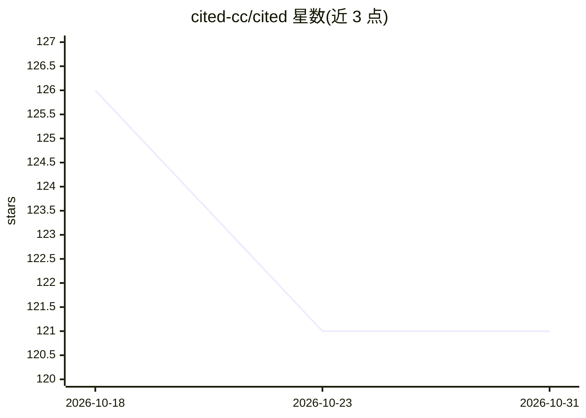

# cited-cc/cited

⭐ 121 · TypeScript · AGPL-3.0 · 推送 2026-10-23 · [GitHub](https://github.com/cited-cc/cited) · [官网](https://cited.cc) · 组织维护

**自托管的开源 AI 引用监测平台：追踪品牌在 AI 回答中的引用**

面向营销团队的品牌引用监测平台：在用户配置的提示词与 AI 表面（ChatGPT、Gemini、Perplexity、Claude、Google AI Overviews/Mode）上运行扫描，保存不可变的回答快照，并对引用、提及、推荐与竞品出现进行分类，输出证据账本、收件箱审核流与竞品追踪。通过 Mock 提供商离线演示，接 DataForSEO（自带凭据）做真实监测。以 Docker Compose 自托管，社区版 AGPL-3.0，另有托管版 Cited Cloud。限制：不监测全部 AI 回答，表面可用性取决于所选提供商；未声明通过渗透测试或合规认证。

## 筛选速览

| 维度 | 判定 | 备注 |
|---|---|---|
| AI 角色 | `ai-ecosystem` | LLM/agent 周边工具 |
| 许可风险 | `viral` | AGPL-3.0 |
| 部署形态 | `self-host` | docker 或自建部署 |
| 模型依赖 | — | README 未给出锁定关系 |
| 硬件要求 | — | 无带数字的原话,不猜 |
| 安装摩擦 | `low` | 无编译、无系统依赖或容器化 |
| 成熟度 | `idea` | |

## 能力要点

- 按配置的提示词与 AI 表面监测品牌引用/提及/推荐
- 不可变回答快照与证据账本、收件箱审核流
- Mock 提供商离线演示（数据标注 [MOCK]）
- Docker Compose 自托管，密钥自动生成于 .cited/secrets/

## 适用场景

- 营销团队获取品牌被 AI 助手引用/推荐的证据
- 追踪竞品在相同提示词下的出现情况
- 离线用虚构数据演示与验证平台功能

## 场景标签

 · 领域:AI 搜索/品牌监测（GEO）

## 证据(README 行号)

> L10:  Cited is the open-source citation monitoring platform. Track when AI assistants mention, recommend, and cite your 
> L20: Marketing teams need evidence when AI assistants cite, mention, or recommend their brand. Cited runs the prompts yo
> L37: 4. Cited classifies citations, mentions, recommendations, and competitor events

## 星数曲线

2026-10-18 126 → 2026-10-31 121（-5）

---
*卡片 v1 · prompt 1.4 · 生成 2026-10-23 · 置信度 high · 依据 README sha `f4d1a73d55ec` · [字段定义](../../DATASET.md)*
