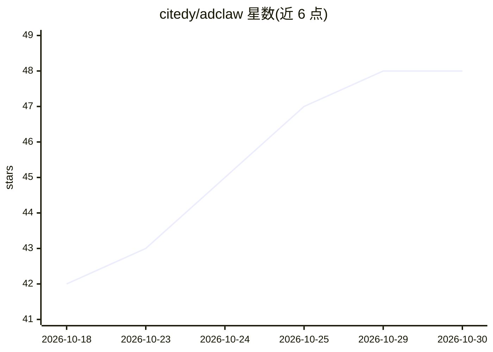

# citedy/adclaw

⭐ 48 · Python · Apache-2.0 · 推送 2026-07-31 · [GitHub](https://github.com/citedy/adclaw) · [官网](https://pypi.org/project/adclaw/) · 组织维护 · 中文 README

**面向营销场景的多 agent AI 团队：人格分工+技能+共享记忆**

以 pip 包或 Docker 部署的多 agent AI 营销团队：创建带独立身份（SOUL.md）、LLM、技能与定时任务的专业 agent（研究员/写手/SEO/广告），支持 Telegram 等渠道内 @tag 路由与协调者自动委派。内置 122 个技能、25 个 MCP 服务器，支持 24 家 LLM 提供商与失败自动切换备链。记忆系统为双层架构：ReMe（按 agent 文件记忆）+ AOM（SQLite+向量检索共享记忆），含摄取清洗、矛盾检测与合并整理。接入 Clawsy 分布式任务网络需单独 API key。

## 筛选速览

| 维度 | 判定 | 备注 |
|---|---|---|
| AI 角色 | `ai-native` | 本体是模型或模型工具 |
| 许可风险 | `permissive` | Apache-2.0 |
| 部署形态 | `self-host` | docker 或自建部署 |
| 模型依赖 | — | README 未给出锁定关系 |
| 硬件要求 | — | 无带数字的原话,不猜 |
| 安装摩擦 | `low` | 无编译、无系统依赖或容器化 |
| 成熟度 | — | 结构信号不足 |

## 能力要点

- 多 agent 人格：每个 agent 独立身份/LLM/技能/cron 调度，@tag 路由与协调者委派
- 122 个内置技能 + 25 个 MCP 服务器 + 52 个营销工具
- 24 家 LLM 提供商、150+ 模型，主模型失败自动切换备链
- 双层记忆：ReMe 文件记忆 + AOM 共享向量记忆（SQLite+sqlite-vec+FTS5）

## 适用场景

- 组建自动运行的营销内容、SEO 与广告 agent 团队
- 在 Telegram/Discord/飞书等渠道里 @指定 agent 分发任务
- 让 agent 接入分布式任务板领取并提交工作换 karma

## 场景标签

`Agent 框架` `多智能体` `Agent 记忆` · 领域:Agent 开发

## 证据(README 行号)

> L17: `pip install adclaw` — and you get a **multi-agent AI marketing team** with:
> L19: - **Multi-agent personas** — create specialized agents (researcher, writer, SEO, ads), each with its own identity (
> L23: - **122 built-in skills** — SEO (19 skills + 30 reference files), ads (18 skills + 23 reference files), content, so

## 星数曲线

2026-10-18 42 → 2026-10-30 48（+6）

---
*卡片 v1 · prompt 1.4 · 生成 2026-10-25 · 置信度 high · 依据 README sha `caf30363c403` · [字段定义](../../DATASET.md)*
