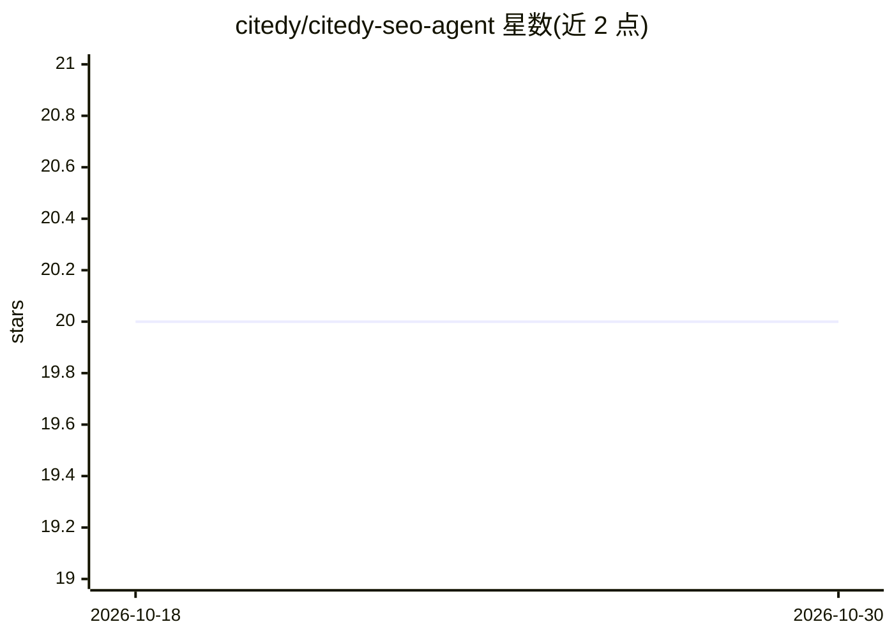

# citedy/citedy-seo-agent

⭐ 20 · JavaScript · MIT · 推送 2026-06-09 · [GitHub](https://github.com/citedy/citedy-seo-agent) · [官网](https://www.citedy.com) · 组织维护

**把 AI agent 接入 Citedy 平台的 SEO 内容营销技能包**

遵循开放 Agent Skills 标准的技能包：导入后使 Claude Code、OpenAI Codex CLI、Factory Droid、Cursor、Windsurf、Manus、Kimi、AutoGPT Builder 等平台上的 AI agent 连接 Citedy 平台，执行趋势侦察（X/Reddit）、竞品分析、SEO 扫描、55 种语言文章生成、AI 插图与配音、社媒改写与自动发布（LinkedIn/X/Facebook/Reddit/Instagram/YouTube Shorts/TikTok 等 7+ 平台）、内容摄取与 lead magnet 生成，支持 cron 定时会话。依赖 Citedy API key，按积分计费（新账号 100 免费积分）。

## 筛选速览

| 维度 | 判定 | 备注 |
|---|---|---|
| AI 角色 | `ai-ecosystem` | LLM/agent 周边工具 |
| 许可风险 | `permissive` | MIT |
| 部署形态 | `library` | 以包/库形式分发 |
| 模型依赖 | — | README 未给出锁定关系 |
| 硬件要求 | — | 无带数字的原话,不猜 |
| 安装摩擦 | `low` | 无编译、无系统依赖或容器化 |
| 成熟度 | — | 结构信号不足 |

## 能力要点

- 覆盖侦察→生成→增强→多平台分发的内容工作流
- 55 种语言的 SEO 文章生成与 9 类平台社媒改写
- cron 定时会话实现周期性自动生成与发布
- 兼容 Claude Code、Codex CLI、Cursor、Windsurf、AutoGPT 等多种 agent 平台

## 适用场景

- 让我的 AI agent 自动侦察热点并产出多语言 SEO 文章
- 把一篇文章自动改写并发布到多个社交媒体平台
- 定时自动生成和发布博客内容
- 从 YouTube/PDF/音频中提取结构化内容素材

## 场景标签

`工作流自动化` `AI 写作` `文档解析` · 领域:效率与自动化

## 证据(README 行号)

> L7: > **citedy-seo-agent** is an Agent Skill that connects your AI agent to the Citedy platform, transforming it into a 
> L85: ## Compatible Platforms
> L113: - `SKILL.md` — canonical Agent Skill definition (OpenClaw/Agent Skills/TinyClaw)

## 星数曲线

2026-10-18 20 → 2026-10-30 20（+0）

---
*卡片 v1 · prompt 1.4 · 生成 2026-10-28 · 置信度 high · 依据 README sha `8f4da8025c99` · [字段定义](../../DATASET.md)*
