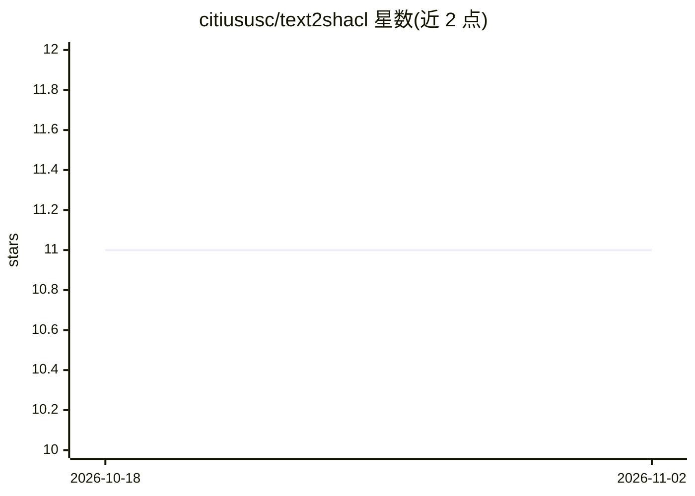

# citiususc/text2shacl

⭐ 11 · HTML · Apache-2.0 · 推送 2026-05-08 · [GitHub](https://github.com/citiususc/text2shacl) · 组织维护

**面向铁路本体的多 agent 系统：从文本自动生成 SHACL 约束**

基于 LangGraph 多 agent 工作流的系统：输入 ERA 铁路本体与 RINF 应用指南 HTML 文档，经 HTML 预处理、RAG 索引（Chroma + Redis）、SHACL 生成与后处理合并，输出 Turtle 格式的 SHACL 校验形状。推理依赖 Databricks AI Gateway，也支持 HuggingFace 模型。已用五个 LLM（Gemma 3、GPT-OSS 120B、Llama 3.3 70B、Mixtral 8x7B、Qwen3-Next）对两个版本指南评测，并提供质量评估（P/R/F1）与可视化脚本。由 CiTIUS（圣地亚哥-德孔波斯特拉大学）团队开发。

## 筛选速览

| 维度 | 判定 | 备注 |
|---|---|---|
| AI 角色 | `ai-native` | 本体是模型或模型工具 |
| 许可风险 | `permissive` | Apache-2.0 |
| 部署形态 | `None` |  |
| 模型依赖 | — | README 未给出锁定关系 |
| 硬件要求 | — | 无带数字的原话,不猜 |
| 安装摩擦 | `low` | 无编译、无系统依赖或容器化 |
| 成熟度 | — | 结构信号不足 |

## 能力要点

- 四步流水线：HTML 预处理、RAG 索引（Chroma/Redis）、LangGraph 多 agent 生成、后处理合并
- 支持五个 LLM 评测，最佳配置 GPT-OSS 120B 达 TC F1 0.904
- 提供与 Astrea 基线合并的 priority-llm / restrictive 两种策略
- 内置质量评估（P/R/F1 三级指标）与图表生成脚本

## 适用场景

- 为大型 OWL 本体自动生成 SHACL 校验形状
- 复现 ERA/RINF 铁路基础设施数据的约束生成实验
- 对比不同 LLM 与合并策略在 SHACL 生成上的效果

## 场景标签

`多智能体` `知识图谱` `RAG` `模型评测` · 领域:Agent 开发

## 证据(README 行号)

> L3: ## An Ontology-Driven Multi-Agent System for Extracting SHACL from ERA Business Rules
> L5: **text2shacl** addresses the challenge of manually creating SHACL validation shapes for large OWL ontologies. Given 
> L7: The system has been evaluated on two versions of the RINF Application Guide: **v3.1.0** (native HTML) and **v1.6.1**

## 星数曲线

2026-10-18 11 → 2026-11-02 11（+0）

---
*卡片 v1 · prompt 1.4 · 生成 2026-11-02 · 置信度 high · 依据 README sha `6ebdf8bf9dd7` · [字段定义](../../DATASET.md)*
