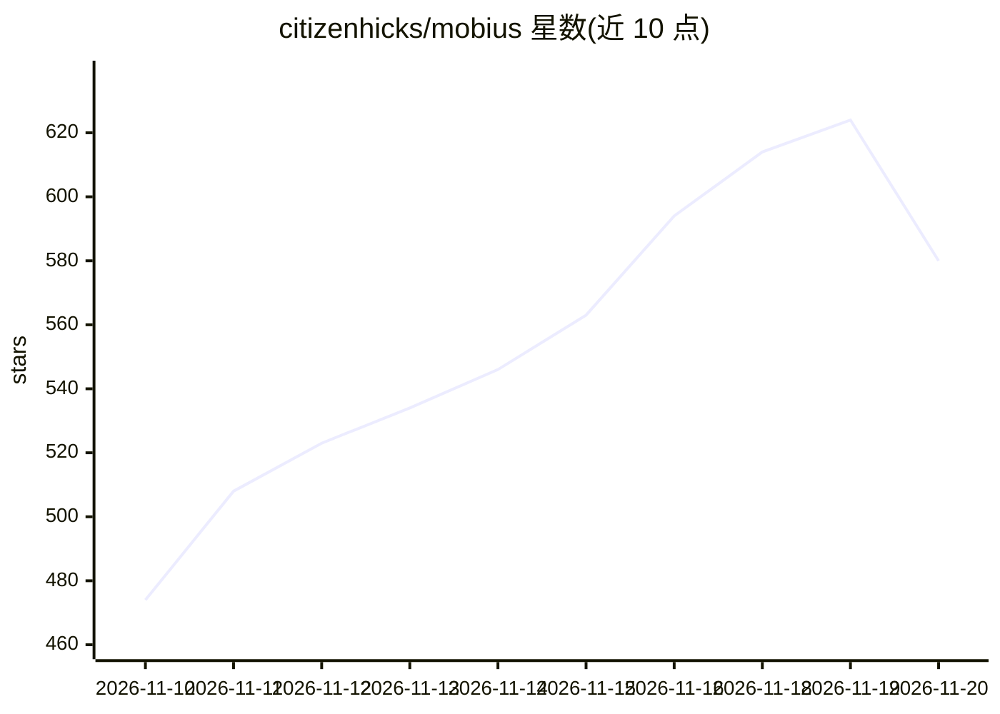

# citizenhicks/mobius

⭐ 580 · Rust · Apache-2.0 · 推送 2026-11-18 · [GitHub](https://github.com/citizenhicks/mobius) · [官网](https://mobius.thinkingsand.dev) · 个人维护

**给开发者的 Rust 编码 agent 运行时框架**

möbius 是一个开源的编码 agent 运行时，包含四部分：Rust agent 框架 crate（可嵌入，提供模型/沙箱/存储/中间件可插拔组合）、headless 网关服务器（托管 Bot、会话与定时任务）、终端客户端与原生 macOS 应用。内置 OpenAI、Anthropic、DeepSeek、OpenRouter 等模型接入，命令在 Seatbelt/Bubblewrap 沙箱中执行，客户端可跨 Mac、终端、iPhone/iPad 共享同一会话。Apache-2.0 许可。

## 筛选速览

| 维度 | 判定 | 备注 |
|---|---|---|
| AI 角色 | `ai-ecosystem` | LLM/agent 周边工具 |
| 许可风险 | `permissive` | Apache-2.0 |
| 部署形态 | `library` | 以包/库形式分发 |
| 模型依赖 | locked-api |  |
| 硬件要求 | — | 无带数字的原话,不猜 |
| 安装摩擦 | `low` | 无编译、无系统依赖或容器化 |
| 成熟度 | — | 结构信号不足 |

## 能力要点

- 四包结构：框架 crate、网关、CLI、macOS 应用，共享版本号
- 内置 OpenAI/Anthropic/DeepSeek/Kimi/Mistral/OpenRouter 等 provider 及 OpenAI Responses API 兼容端点
- 命令在 Seatbelt（macOS）/Bubblewrap（Linux）沙箱执行，支持审批策略
- Bot/Routine/Subagent/MCP 之外的 Agent Skills 与插件能力开关

## 适用场景

- 在 Rust 中嵌入并构建自己的编码 agent 或前端
- 自托管网关，从 Mac、终端与 iOS 设备继续同一会话
- 通过 Bot 配置模型、工具与审批策略执行编码任务

## 场景标签

`Agent 框架` · 领域:Agent 开发

## 证据(README 行号)

> L6:  An open-source runtime for coding agents.
> L23: |`mobius`|`src/`|The agent framework: one session and its model and tool loop, with pluggable models, sandboxes, st

## 星数曲线

2026-11-10 474 → 2026-11-20 580（+106）

---
*卡片 v1 · prompt 1.4 · 生成 2026-11-17 · 置信度 high · 依据 README sha `733987e2223f` · [字段定义](../../DATASET.md)*
