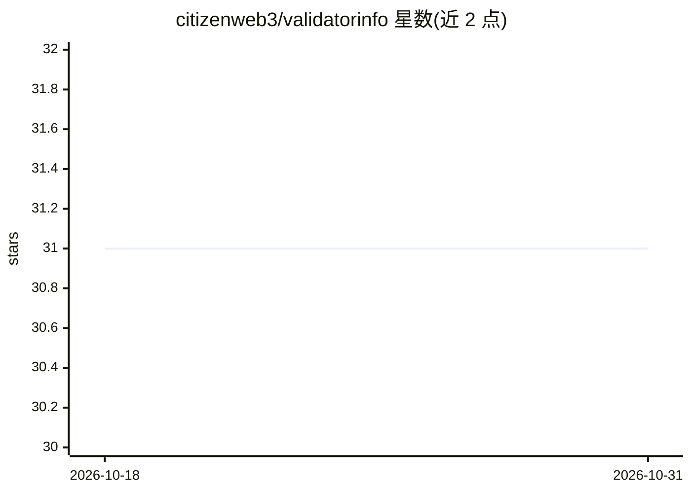

# citizenweb3/validatorinfo

⭐ 31 · TypeScript · NOASSERTION · 推送 2026-08-10 · [GitHub](https://github.com/citizenweb3/validatorinfo) · [官网](https://validatorinfo.com/) · 组织维护

**自托管 Web3 区块链浏览器与链上数据仪表盘**

Citizen Web3 团队维护的区块链浏览器项目：索引 25+ 条链的验证人、矿池、代币与网络实时指标，提供交互式链上仪表盘、去中心化论坛、P2P 聊天、代币交换与 Web3 登录，含 AI 聊天机器人功能。支持源码方式运行（Node.js/yarn/pm2/Makefile 流程）与 Docker Compose 部署（含 PostgreSQL、Redis、迁移、前端与索引服务）。项目由团队在自建离网硬件上自托管运行。

## 筛选速览

| 维度 | 判定 | 备注 |
|---|---|---|
| AI 角色 | `ai-enhanced` | 去掉 AI 部分产品仍成立 |
| 许可风险 | `none` | NOASSERTION |
| 部署形态 | `self-host` | docker 或自建部署 |
| 模型依赖 | — | README 未给出锁定关系 |
| 硬件要求 | — | 无带数字的原话,不猜 |
| 安装摩擦 | `low` | 无编译、无系统依赖或容器化 |
| 成熟度 | — | 结构信号不足 |

## 能力要点

- 覆盖 25+ 条链的验证人/矿池/代币/网络实时指标
- 内置去中心化论坛、P2P 聊天、代币交换与 Web3 登录
- 提供 Docker Compose 开发环境（PostgreSQL/Redis/迁移/前端/索引服务）
- 含 AI 聊天机器人

## 适用场景

- 自托管一个多链区块链浏览器与链上数据仪表盘
- 查看验证人与矿池的实时链上指标
- 在私有环境中运行带论坛与聊天的链上数据平台

## 场景标签

 · 领域:区块链/Web3 数据服务

## 证据(README 行号)

> L4: > Web3 Blockchain Explorer. Validator, Mining Pool, Token and Network Real-time Metrics
> L14: > Unique design. Interactive UI. Private dashboards. AI chatbot and more...

## 星数曲线

2026-10-18 31 → 2026-10-31 31（+0）

---
*卡片 v1 · prompt 1.4 · 生成 2026-10-26 · 置信度 low · 依据 README sha `8e01e359f9ef` · [字段定义](../../DATASET.md)*
