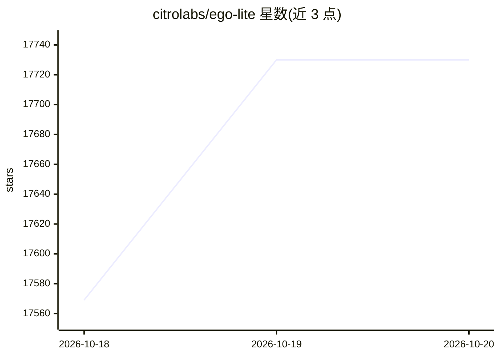

# citrolabs/ego-lite

⭐ 17,730 · JavaScript · MIT · 推送 2026-10-19 · [GitHub](https://github.com/citrolabs/ego-lite) · [官网](https://lite.ego.app) · 组织维护 · 中文 README

**让 AI agent 与用户共享同一浏览器的自动化浏览器**

ego lite 是一款为 AI agent 设计的浏览器：agent 在浏览器内的隔离 Space 中执行自动化任务，用户可同时继续使用自己的标签页，并可通过迁移 Chrome 数据让 agent 继承已有登录、Cookie 与扩展。agent 经 `ego-browser` 技能连接层（支持 Claude Code、Codex、Cursor 等命令行 agent），以页面内 JavaScript 工具（snapshot、fill、click、navigate 等）驱动浏览器。当前仅支持 macOS（Apple Silicon/Intel），Windows 封测、Linux 在路线图中；MIT 许可，仓库内容与浏览器本体分发分离。

## 筛选速览

| 维度 | 判定 | 备注 |
|---|---|---|
| AI 角色 | `ai-native` | 本体是模型或模型工具 |
| 许可风险 | `permissive` | MIT |
| 部署形态 | `library` | 以包/库形式分发 |
| 模型依赖 | — | README 未给出锁定关系 |
| 硬件要求 | — | 无带数字的原话,不猜 |
| 安装摩擦 | `low` | 无编译、无系统依赖或容器化 |
| 成熟度 | — | 结构信号不足 |

## 动量与使用信号

- 维护:`active` — 距上次 push 2.0 天,年发版 14,10 位贡献者
- 涨星:近 1 天 **+95**(自 20261016 起算)
- 安装:npm 包 `skills` 月下载 23,786,800
- 平台:WINDOWS / MACOS / LINUX · 协议:—

## 能力要点

- 每个 agent 拥有隔离 Space，多任务并行且不占用用户标签页
- ego-browser 技能将浏览器暴露为页面内 JavaScript 工具集
- 首次启动可迁移 Chrome 数据（登录、Cookie、扩展、书签）
- 提供 npx skills add 安装 ego-browser 技能

## 适用场景

- 让 Claude Code/Codex 在我保持浏览的同时并行执行网页操作
- 让 agent 复用我已登录的账号状态完成自动化任务
- 多个 agent 同时抓取或处理多个站点而不互相冲突

## 场景标签

`浏览器自动化` · 领域:效率与自动化

## 证据(README 行号)

> L24: ego (lite) is a browser where you and your AI agents work in parallel. Your agents run their browser tasks in their
> L89: |**Any agent can drive it through `ego-browser`**|`ego-browser` is the connection layer between any agent CLI (Clau
> L96: |Capability|ego lite|Browser-Use|agent-browser (Vercel)|ChatGPT Atlas|Perplexity Comet|

## 星数曲线

2026-10-18 17,569 → 2026-10-20 17,730（+161）

---
*卡片 v1 · prompt 1.4 · 生成 2026-10-18 · 置信度 high · 依据 README sha `3626d6140986` · [字段定义](../../DATASET.md)*
