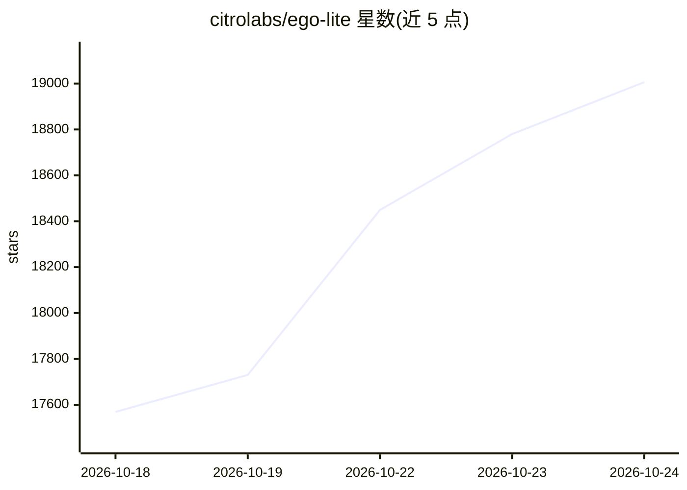

# citrolabs/ego-lite

⭐ 19,185 · JavaScript · MIT · 推送 2026-10-23 · [GitHub](https://github.com/citrolabs/ego-lite) · [官网](https://lite.ego.app) · 组织维护 · 中文 README

**供 AI agent 共享登录态并行执行网页自动化的浏览器**

ego lite 是一个面向 AI agent 的浏览器：用户与 agent 在同一浏览器内并行工作，每个 agent 在独立的 Space 隔离工作区运行任务，不打扰用户当前浏览。通过 ego-browser 技能把浏览器能力暴露为页面内 JavaScript 工具（snapshot、fill、click、navigate 等），供 Claude Code、Codex、Cursor 等 agent CLI 调用，并可迁移 Chrome 登录态与数据；数据保存在本地。提供 macOS（Apple Silicon/Intel）与 Windows 安装包，Linux 在路线图中。

## 筛选速览

| 维度 | 判定 | 备注 |
|---|---|---|
| AI 角色 | `ai-ecosystem` | LLM/agent 周边工具 |
| 许可风险 | `permissive` | MIT |
| 部署形态 | `library` | 以包/库形式分发 |
| 模型依赖 | — | README 未给出锁定关系 |
| 硬件要求 | — | 无带数字的原话,不猜 |
| 安装摩擦 | `low` | 无编译、无系统依赖或容器化 |
| 成熟度 | — | 结构信号不足 |

## 动量与使用信号

- 维护:`active` — 距上次 push 2.0 天,年发版 14,10 位贡献者
- 涨星:近 1 天 **+95**(自 20261016 起算)
- 安装:npm 包 `skills` 月下载 23,786,800
- 平台:WINDOWS / MACOS / LINUX · 协议:—

## 能力要点

- 每个 agent 独立隔离的 Space 并行工作区
- ego-browser 技能将浏览器能力暴露为页面内 JavaScript 工具
- 支持迁移 Chrome 登录态、cookies 与扩展，数据存本地
- 以代码而非 CLI 循环方式执行任务，减少调用次数

## 适用场景

- 让 Claude Code/Codex 等 agent 复用我的登录态做网页自动化
- 多任务并行：多个 agent 在各自 Space 同时抓取或操作网页
- 我正常浏览的同时让 agent 后台完成网页任务

## 场景标签

`浏览器自动化` · 领域:效率与自动化

## 证据(README 行号)

> L25: ego (lite) is a browser where you and your AI agents work in parallel. Your agents run their browser tasks in their
> L91: |**Any agent can drive it through `ego-browser`**|`ego-browser` is the connection layer between any agent CLI (Clau

## 星数曲线

2026-10-18 17,569 → 2026-10-24 19,006（+1,437）

---
*卡片 v1 · prompt 1.4 · 生成 2026-10-20 · 置信度 high · 依据 README sha `84c5aafd4345` · [字段定义](../../DATASET.md)*
