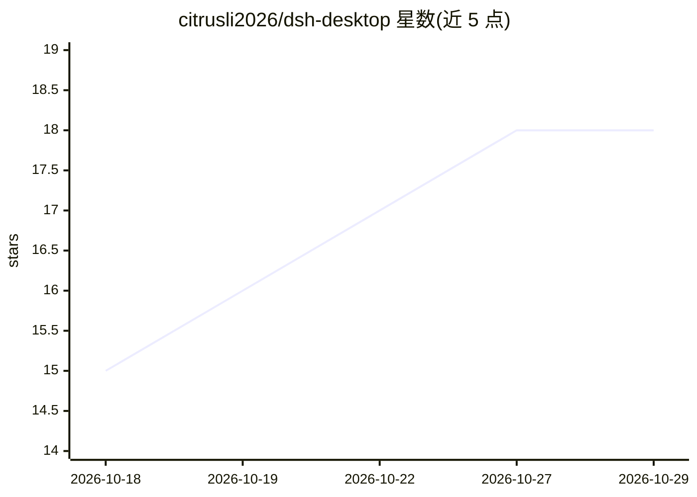

# citrusli2026/dsh-desktop

⭐ 18 · TypeScript · MIT · 推送 2026-10-28 · [GitHub](https://github.com/citrusli2026/dsh-desktop) · [官网](https://dsh-desktop.com) · 个人维护 · 中文 README

**DeepSeek Harness 官方 WebUI 的非官方 Electron 桌面封装**

社区维护的个人项目，将 DeepSeek Harness（@deepseek-ai/dsh）的官方 WebUI 打包为桌面应用，功能等同 npx @deepseek-ai/dsh web。内嵌固定版本的 Node.js 24 与完整依赖闭包，免终端安装；提供原生窗口与托盘、崩溃自动重启、安全模式隔离故障插件、一键健康检查、诊断报告导出、Windows 原地自动更新、Feishu 连接管理、LAN 移动端配对等功能。安装器未签名，社区插件默认不内置，需手动安装。提供 macOS/Windows/Linux 安装包。

## 筛选速览

| 维度 | 判定 | 备注 |
|---|---|---|
| AI 角色 | `ai-ecosystem` | LLM/agent 周边工具 |
| 许可风险 | `permissive` | MIT |
| 部署形态 | `desktop` | 安装包/桌面程序 |
| 模型依赖 | locked-api |  |
| 硬件要求 | — | 无带数字的原话,不猜 |
| 安装摩擦 | `low` | 无编译、无系统依赖或容器化 |
| 成熟度 | — | 结构信号不足 |

## 能力要点

- 内嵌固定 Node.js 24 运行时与 dsh 依赖闭包，免环境配置
- 崩溃自动重启、安全模式隔离第三方插件、导出式诊断报告
- Windows 原地自动更新，macOS 跳转 release 页检查
- 独立数据目录 ~/.dsh-desktop，与 CLI 数据隔离

## 适用场景

- 不想装 Node.js/用终端，直接以桌面应用方式使用 DeepSeek Harness WebUI
- 需要桌面窗口、托盘、全局快捷键等桌面体验
- 以图形界面排查插件故障并导出诊断报告

## 场景标签

`编码 Agent` · 领域:编码与开发

## 证据(README 行号)

> L5: A dependable Electron desktop shell for DeepSeek Harness (`dsh`): the official WebUI, packaged for your desktop — do
> L35: - **No runtime setup** — bundles a pinned Node.js 24 runtime and the complete `@deepseek-ai/dsh` dependency closure

## 星数曲线

2026-10-18 15 → 2026-10-29 18（+3）

---
*卡片 v1 · prompt 1.4 · 生成 2026-10-29 · 置信度 mid · 依据 README sha `261c75a537dc` · [字段定义](../../DATASET.md)*
