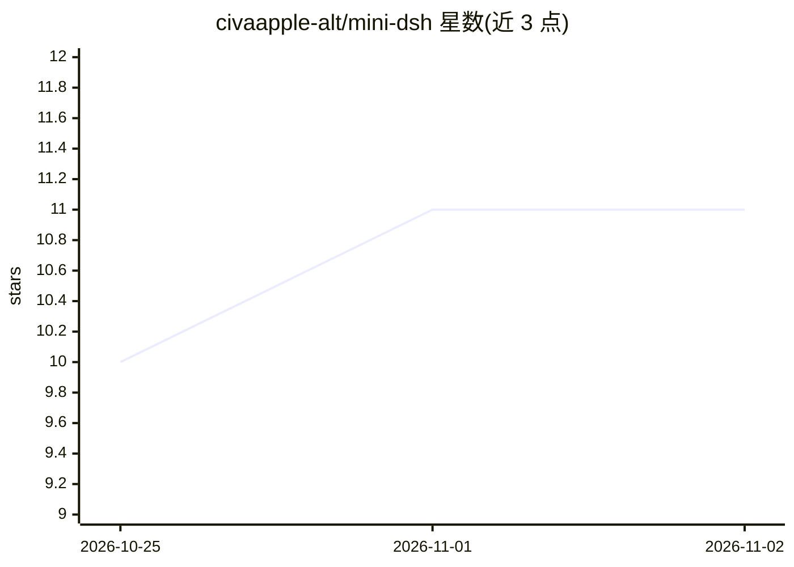

# civaapple-alt/mini-dsh

⭐ 11 · TypeScript · MIT · 推送 2026-08-18 · [GitHub](https://github.com/civaapple-alt/mini-dsh) · 个人维护 · 中文 README

**学习 Cordis 微内核的极简 DeepSeek Harness 架构实现**

基于 Cordis 微内核框架的极简版 DeepSeek Harness（DSH）架构教学实现：以“一切皆插件”组织前后端能力，Host 端运行 Node.js Cordis Context 并分发前端 Bundle，浏览器端以插槽机制挂载插件 UI。支持 YAML Profile 切换系统能力、Include & Patch 增量补丁、本地/云端沙箱执行世界无感切换、多会话隔离、Schemastery 配置校验与 HMR 热重载。以 pnpm monorepo 形式提供，含 Web GUI 与 Headless 两种运行模式及配套学习指南。

## 筛选速览

| 维度 | 判定 | 备注 |
|---|---|---|
| AI 角色 | `ai-ecosystem` | LLM/agent 周边工具 |
| 许可风险 | `permissive` | MIT |
| 部署形态 | `library` | 以包/库形式分发 |
| 模型依赖 | — | README 未给出锁定关系 |
| 硬件要求 | — | 无带数字的原话,不猜 |
| 安装摩擦 | `low` | 无编译、无系统依赖或容器化 |
| 成熟度 | `idea` | |

## 能力要点

- 前后端对称的全栈插件模型（apply(ctx, config) + 插槽挂载）
- Profile 驱动能力切换与 Include & Patch 全局增量补丁
- Capability Seam：本地与云端沙箱执行环境无感切换
- 同进程多会话隔离与 HMR 实时热重载实验

## 适用场景

- 学习 Cordis 微内核插件化架构设计
- 理解 DeepSeek Harness 的核心机制并对标源码
- 验证插件可插拔、优雅降级与沙箱隔离等架构实验

## 场景标签

`Agent 框架` `教程课程` · 领域:Agent 开发

## 证据(README 行号)

> L3: 本项目是一个极简版（Educational & Minimalist）的 DeepSeek Harness 架构实现，专门用于学习与验证 **Cordis** 框架的核心设计哲学：**“Everything is a plugin”
> L17:  - 所有的功能、服务、API 路由以及前端 UI 组件全部以 Cordis 插件（`apply(ctx, config)`）形式组织。
> L89: 完全对标 DeepSeek Harness 的 `examples/headless-agent/goal.cordis.yml`，在无需复制粘贴 100+ 行配置的情况下，通过 `Include + patches.insert

## 星数曲线

2026-10-25 10 → 2026-11-02 11（+1）

---
*卡片 v1 · prompt 1.4 · 生成 2026-11-02 · 置信度 mid · 依据 README sha `d5c98cf81b9c` · [字段定义](../../DATASET.md)*
