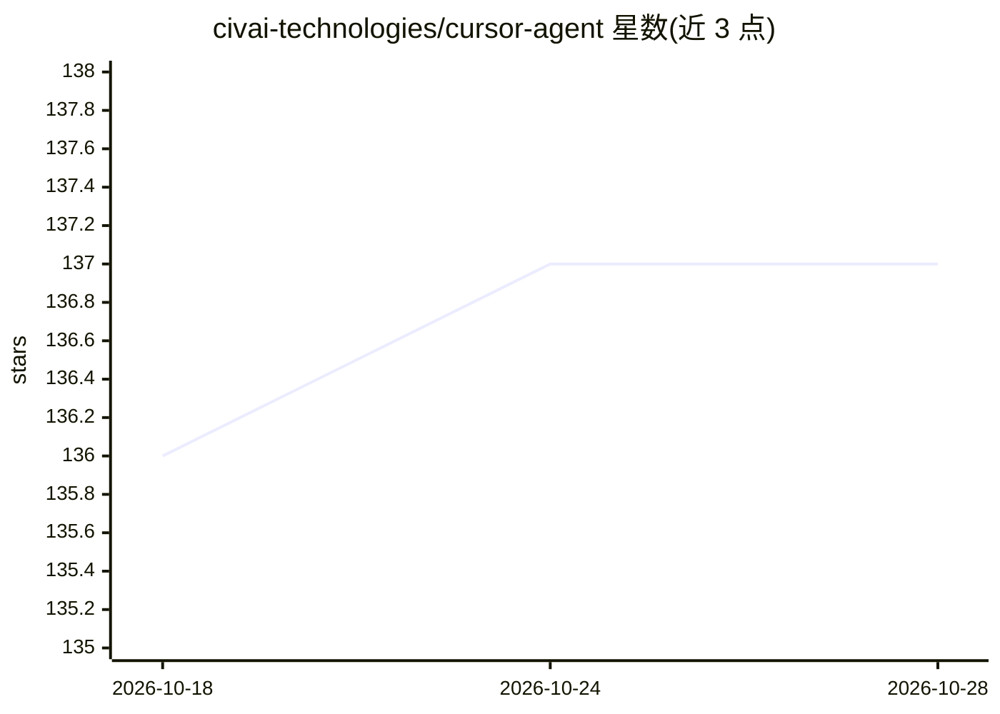

# civai-technologies/cursor-agent

⭐ 137 · Python · MIT · 推送 2026-09-11 · [GitHub](https://github.com/civai-technologies/cursor-agent) · [官网](https://civai.co) · 组织维护

**Python 编码助手 Agent 框架：复刻 Cursor 式代码代理能力**

面向开发者的 Python Agent 库：通过 create_agent 工厂创建编码助手，支持 Anthropic Claude、OpenAI 及本地 Ollama 模型，提供文件读写/编辑、语义与正则代码搜索、网页搜索、图像分析、终端命令执行等内置工具，支持自定义工具注册与系统提示词定制。内置权限系统（默认需确认、YOLO 自动模式、命令黑白名单）与工具调用次数上限确认（默认 5 次需人工批准）。以 pip 包与源码两种方式安装。

## 筛选速览

| 维度 | 判定 | 备注 |
|---|---|---|
| AI 角色 | `ai-ecosystem` | LLM/agent 周边工具 |
| 许可风险 | `permissive` | MIT |
| 部署形态 | `library` | 以包/库形式分发 |
| 模型依赖 | local-ok | 支持本地模型 |
| 硬件要求 | — | 无带数字的原话,不猜 |
| 安装摩擦 | `low` | 无编译、无系统依赖或容器化 |
| 成熟度 | — | 结构信号不足 |

## 能力要点

- 支持 Claude/OpenAI/本地 Ollama 三类模型接入
- 内置文件操作、代码搜索、网页搜索、图像分析、终端执行等工具集
- 权限系统：默认安全确认、YOLO 模式、命令黑白名单、删除保护
- 交互模式自动检测 Agent 请求用户输入并暂停，工具调用达阈值需确认

## 适用场景

- 在自有项目中集成可执行工具调用的编码助手
- 用本地 Ollama 模型构建离线编码代理
- 通过自定义系统提示词与工具注册构建领域专用 Agent

## 场景标签

`Agent 框架` · 领域:Agent 开发

## 证据(README 行号)

> L9: A Python-based AI agent that replicates Cursor's coding assistant capabilities, enabling function calling, code gene
> L17: - **Model Flexibility**: Works with Claude (Anthropic), OpenAI models, and locally hosted Ollama models
> L356: Tools are Python functions registered with the agent. The cursor-agent library supports various types of tools to 

## 星数曲线

2026-10-18 136 → 2026-10-28 137（+1）

---
*卡片 v1 · prompt 1.4 · 生成 2026-10-22 · 置信度 high · 依据 README sha `a6155ff6a0d7` · [字段定义](../../DATASET.md)*
