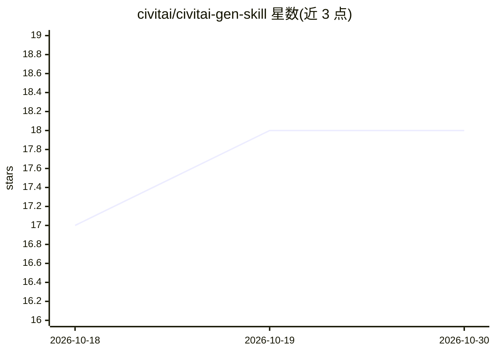

# civitai/civitai-gen-skill

⭐ 18 · JavaScript · MIT · 推送 2026-06-12 · [GitHub](https://github.com/civitai/civitai-gen-skill) · 组织维护

**通过 Civitai API 生成图像/视频/音频的运行时无关 agent 技能**

Civitai 官方维护的 AgentSkills 格式技能：以零 npm 依赖的 Node.js 18+ CLI 封装 Civitai 编排 Workflow API，覆盖文生图、图生图、视频（11+ 引擎）、语音合成、音乐生成、转录等，统一 submit→poll→download 异步生命周期；支持批量、通配符与参数扫描，并提供 0 费用消耗的成本估算。可被 Claude Code、OpenClaw 等技能兼容运行时加载，CLI 本身运行时无关，需 CIVITAI_API_KEY，ffmpeg 为可选依赖。

## 筛选速览

| 维度 | 判定 | 备注 |
|---|---|---|
| AI 角色 | `ai-ecosystem` | LLM/agent 周边工具 |
| 许可风险 | `permissive` | MIT |
| 部署形态 | `library` | 以包/库形式分发 |
| 模型依赖 | — | README 未给出锁定关系 |
| 硬件要求 | — | 无带数字的原话,不猜 |
| 安装摩擦 | `low` | 无编译、无系统依赖或容器化 |
| 成熟度 | — | 结构信号不足 |

## 能力要点

- 统一 submit→poll→download 生命周期覆盖图像/视频/TTS/音乐/转录生成
- 零 npm 依赖、运行时无关的 Node.js CLI，npx skills 一键安装
- 批量生成、通配符与参数扫描，dry-run 成本估算不消耗 buzz
- 配套 Civitai MCP server 负责模型发现与登录写操作，本技能专注生成

## 适用场景

- 让 Claude Code/OpenClaw 等 agent 直接生成图像、视频或语音
- 批量跑生成实验并预估 buzz 成本
- 为 agent 工作流接入 Civitai 的多引擎生成能力

## 场景标签

`图像生成` `视频生成` `语音合成` · 领域:内容生成

## 证据(README 行号)

> L6: An agent skill that generates images, videos, audio, and more through Civitai's orchestration Workflow API. Every ge
> L8: Works with any skills-compatible agent runtime (Claude Code, OpenClaw, Cursor, Codex, and others). It's a self-conta
> L80: Distributed in the AgentSkills format (`SKILL.md` + scripts), installable via `skills.sh`. The CLI itself is runtim

## 星数曲线

2026-10-18 17 → 2026-10-30 18（+1）

---
*卡片 v1 · prompt 1.4 · 生成 2026-10-29 · 置信度 high · 依据 README sha `79e931b8ac40` · [字段定义](../../DATASET.md)*
