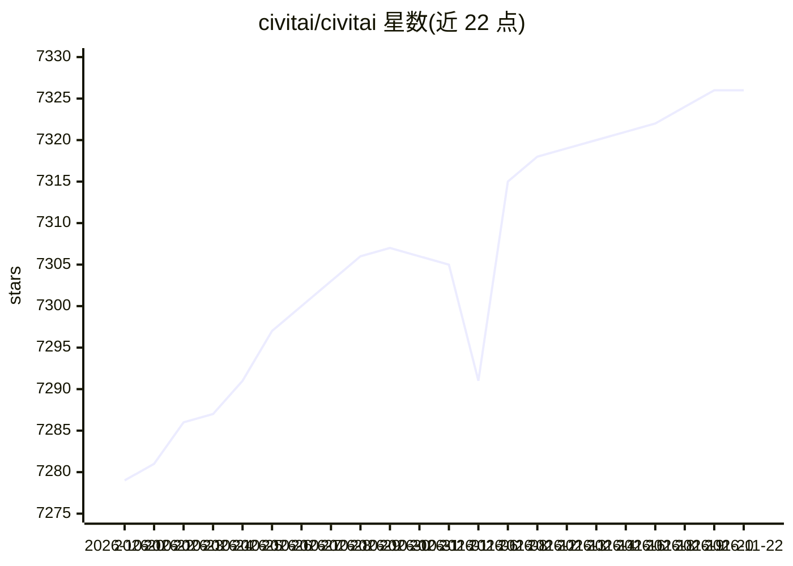

# civitai/civitai

⭐ 7,326 · TypeScript · Apache-2.0 · 推送 2026-11-21 · [GitHub](https://github.com/civitai/civitai) · [官网](https://civitai.com) · 组织维护

**Stable Diffusion 模型分享平台：上传、浏览与交流**

Civitai 的开源平台代码：面向想要分享和获取 Stable Diffusion 相关模型（textual inversion、hypernetwork、aesthetic gradients、VAE 等）的用户，提供账号注册、模型上传、浏览他人模型、评论与反馈等功能。技术栈为 Next.js + tRPC + Prisma/Postgres，存储使用 Cloudflare。README 主要面向贡献者的本地开发部署：通过 Docker Compose 运行数据库、Redis、MinIO 等服务容器。本地环境无法运行需要外部输入的服务，包括生成与训练等编排功能。

## 筛选速览

| 维度 | 判定 | 备注 |
|---|---|---|
| AI 角色 | `ai-ecosystem` | LLM/agent 周边工具 |
| 许可风险 | `permissive` | Apache-2.0 |
| 部署形态 | `self-host` | docker 或自建部署 |
| 模型依赖 | — | README 未给出锁定关系 |
| 硬件要求 | — | 无带数字的原话,不猜 |
| 安装摩擦 | `low` | 无编译、无系统依赖或容器化 |
| 成熟度 | — | 结构信号不足 |

## 能力要点

- 用户可上传、浏览、评论 Stable Diffusion 相关模型资源
- Next.js + tRPC + Prisma/Postgres + Cloudflare 存储的技术栈
- 提供 Docker Compose、Nix flake、devcontainers 三种本地开发环境方案
- 本地部署不包含生成、训练等编排服务

## 适用场景

- 搭建自己的模型分享社区站点
- 参与 Civitai 平台代码的本地开发与贡献
- 自托管环境研究平台的数据库结构与服务组成

## 场景标签

 · 领域:AI 模型社区/平台

## 证据(README 行号)

> L16: Our goal with this project is to create a platform where people can share their stable diffusion models (textual in
> L23: We've built this project using a combination of modern web technologies, including Next.js for the frontend, TRPC f
> L38: - Docker, with Compose v2 (`docker compose`, not the

## 星数曲线

2026-10-20 7,279 → 2026-11-22 7,326（+47）

---
*卡片 v1 · prompt 1.4 · 生成 2026-11-22 · 置信度 mid · 依据 README sha `862b5bc3bd21` · [字段定义](../../DATASET.md)*
