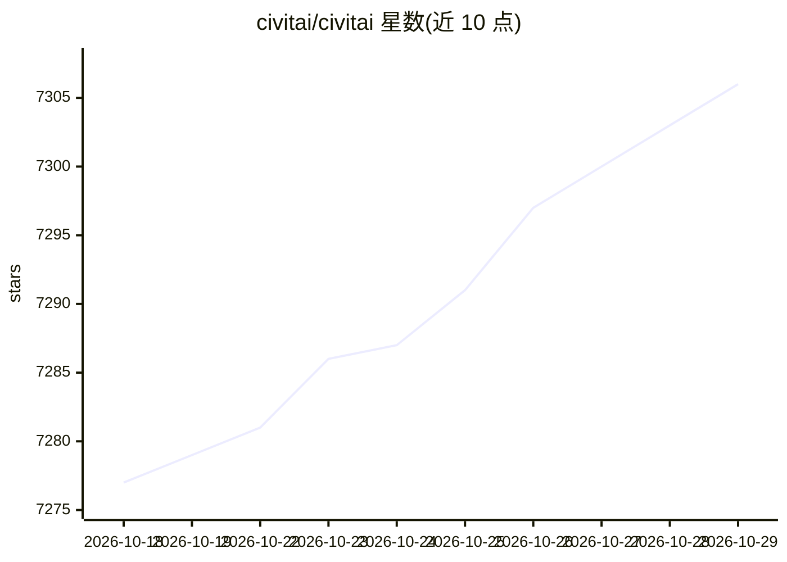

# civitai/civitai

⭐ 7,306 · TypeScript · Apache-2.0 · 推送 2026-10-28 · [GitHub](https://github.com/civitai/civitai) · [官网](https://civitai.com) · 组织维护

**Stable Diffusion 模型分享社区平台的开源代码库**

Civitai 模型分享平台的源码仓库：用于自建一个供用户注册账号、上传与浏览 Stable Diffusion 定制资源（textual inversion、hypernetwork、aesthetic gradient、VAE 等）、互评协作的 Web 平台。技术栈为 Next.js + tRPC + Prisma/Postgres + Mantine，本地运行依赖 Docker Compose 起容器栈（Postgres/Redis/MinIO/Meilisearch/ClickHouse）、Node 24.19.0 与 pnpm。本地已知限制：需要外部输入的服务（生成/训练编排、Signals、Buzz）无法在本地工作。

## 筛选速览

| 维度 | 判定 | 备注 |
|---|---|---|
| AI 角色 | `ai-ecosystem` | LLM/agent 周边工具 |
| 许可风险 | `permissive` | Apache-2.0 |
| 部署形态 | `self-host` | docker 或自建部署 |
| 模型依赖 | — | README 未给出锁定关系 |
| 硬件要求 | — | 无带数字的原话,不猜 |
| 安装摩擦 | `low` | 无编译、无系统依赖或容器化 |
| 成熟度 | — | 结构信号不足 |

## 能力要点

- 支持上传/浏览/评论 Stable Diffusion 定制模型资源的社区平台
- 本地开发用 Docker Compose 起 Postgres/Redis/MinIO/Meilisearch/ClickHouse 容器栈
- 提供标准 setup、可选 Nix flake 与 devcontainer 三种本地启动方式
- Apache 2.0 许可

## 适用场景

- 自建或二次开发一个 AI 生成模型分享社区站点
- 为 Civitai 平台贡献代码或做本地开发调试
- 研究模型分享社区的产品与技术实现

## 场景标签

`图像生成` · 领域:内容生成

## 证据(README 行号)

> L16: Our goal with this project is to create a platform where people can share their stable diffusion models (textual in
> L18: other's work. The platform allows users to create an account, upload their models, and browse models that have been

## 星数曲线

2026-10-18 7,277 → 2026-10-29 7,306（+29）

---
*卡片 v1 · prompt 1.4 · 生成 2026-10-20 · 置信度 mid · 依据 README sha `30de5dcd70c9` · [字段定义](../../DATASET.md)*
