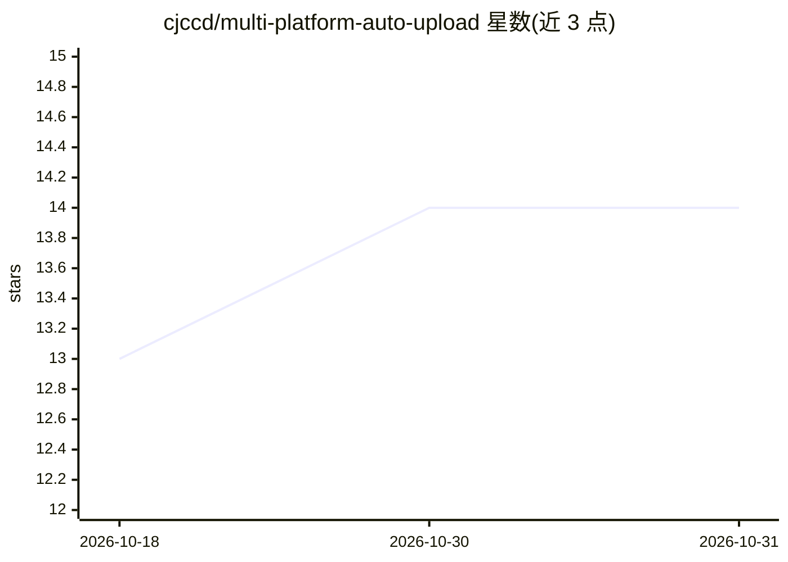

# cjccd/multi-platform-auto-upload

⭐ 14 · Python · MIT · 推送 2026-06-04 · [GitHub](https://github.com/cjccd/multi-platform-auto-upload) · 个人维护 · 中文 README

**多平台视频/图文/商品内容自动发布的 CLI 工具，供人、脚本与 AI agent 调用**

面向创作者、商家和 AI agent 的发布自动化 CLI（mpau）：通过浏览器自动化（patchright）向抖音、微信视频号、拼多多、天猫/淘宝、京东、快手、小红书、B站、百家号、TikTok 等 10 个平台上传视频、图文，支持定时发布和挂商品链接/商品 ID，提供 login/check/upload/verify 命令与按平台组织的日志。仓库附带 skills/ 目录下的 SKILL.md 技能文件，agent 可读取后调用 CLI 并检查日志；另有可选的视频分析技能（抽帧、语音转文字）。MIT 许可。

## 筛选速览

| 维度 | 判定 | 备注 |
|---|---|---|
| AI 角色 | `ai-enhanced` | 去掉 AI 部分产品仍成立 |
| 许可风险 | `permissive` | MIT |
| 部署形态 | `None` |  |
| 模型依赖 | — | README 未给出锁定关系 |
| 硬件要求 | — | 无带数字的原话,不猜 |
| 安装摩擦 | `low` | 无编译、无系统依赖或容器化 |
| 成熟度 | — | 结构信号不足 |

## 能力要点

- 覆盖 10 个社交/电商平台的视频与图文上传、定时发布
- 支持商品链接/商品 ID（抖音、微信小店、拼多多、淘宝/天猫、京东）
- 内置 SKILL.md 格式的 agent 技能与日志化执行，agent 可读取调用
- 可选视频分析技能：抽帧、语音转文字、JSON 输出

## 适用场景

- 我一次性制作内容后自动分发到多个社交和电商平台
- 让 AI agent 代替我执行跨平台发布并检查结果
- 电商带货视频自动挂商品链接定时发布

## 场景标签

`浏览器自动化` · 领域:效率与自动化

## 证据(README 行号)

> L13:  One CLI to publish videos, notes, product content and scheduled posts across social media and e-commerce platforms
> L111: ## AI Agent ready

## 星数曲线

2026-10-18 13 → 2026-10-31 14（+1）

---
*卡片 v1 · prompt 1.4 · 生成 2026-10-31 · 置信度 mid · 依据 README sha `7e0424b7abe4` · [字段定义](../../DATASET.md)*
