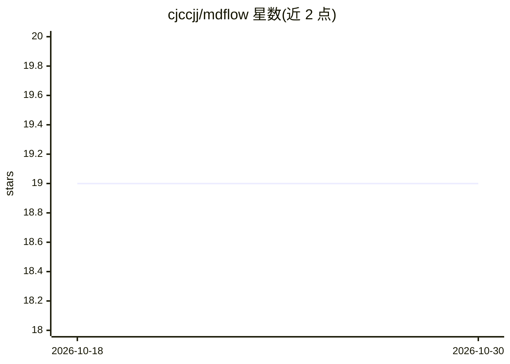

# cjccjj/mdflow

⭐ 19 · C · NOASSERTION · 推送 2026-09-11 · [GitHub](https://github.com/cjccjj/mdflow) · [官网](https://github.com/cjccjj/mdflow#readme) · 个人维护

**流式 Markdown 转 ANSI 终端渲染的 C CLI/库**

面向流式输入场景的终端 Markdown 渲染工具：在输入到达过程中即时格式化输出，不等 EOF、不缓存整篇文档、不重复解析。基于 MD4C 改造的流式解析器（MD4CS）与 ANSI 渲染器组成，无 AST。以 C 编写的 CLI 和 libc-only 嵌入库提供，支持 CommonMark（652 例测试）与 GFM 表格、任务列表、脚注等；提供表格布局、CJK/emoji、OSC 8 链接、语法高亮，流式限制（引用链接、脚注）单独文档化。

## 筛选速览

| 维度 | 判定 | 备注 |
|---|---|---|
| AI 角色 | `ai-ecosystem` | LLM/agent 周边工具 |
| 许可风险 | `none` | NOASSERTION |
| 部署形态 | `None` |  |
| 模型依赖 | — | README 未给出锁定关系 |
| 硬件要求 | — | 无带数字的原话,不猜 |
| 安装摩擦 | `medium` | 含编译或系统依赖之一 |
| 成熟度 | — | 结构信号不足 |

## 能力要点

- 真流式渲染：不等 EOF、不整篇缓存、不重复解析
- 基于 MD4C 改造的流式解析器 MD4CS，无 AST 无文档缓冲
- CommonMark 652 例测试覆盖，GFM 表格/任务列表/脚注/告示块支持
- C CLI 与 libc-only 嵌入库两种形态，306 KB 二进制

## 适用场景

- 让 LLM CLI 输出在终端实时显示为格式化 Markdown
- 为自己的 CLI 工具通过管道添加 Markdown 渲染
- 作为 C 库嵌入到需要终端 Markdown 显示的程序中

## 场景标签

 · 领域:开发者工具/终端渲染

## 证据(README 行号)

> L3: **mdflow is a true streaming Markdown-to-ANSI renderer for LLM output.** It
> L24: - **Live output:** see formatted Markdown while an LLM response is still arriving.
> L120: received so far. That makes it a natural fit for live LLM output and other

## 星数曲线

2026-10-18 19 → 2026-10-30 19（+0）

---
*卡片 v1 · prompt 1.4 · 生成 2026-10-28 · 置信度 high · 依据 README sha `8941f020426d` · [字段定义](../../DATASET.md)*
