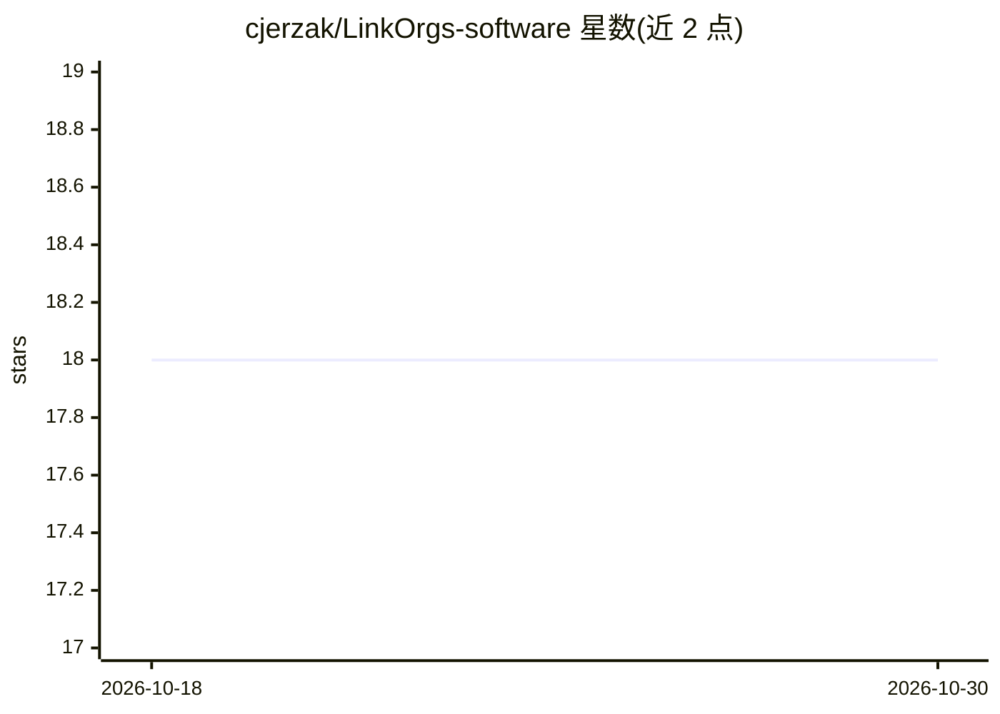

# cjerzak/LinkOrgs-software

⭐ 18 · R · MIT · 推送 2026-07-13 · [GitHub](https://github.com/cjerzak/LinkOrgs-software) · [官网](https://doi.org/10.1017/psrm.2024.55) · 个人维护

**R 语言组织名记录链接包：用 5 亿条 LinkedIn 开放协作记录做匹配**

面向研究者与数据分析师的 R 包，解决跨数据集的组织名称记录链接问题。提供 5 种算法：fuzzy（并行化字符串距离匹配，无需联网）、bipartite 与 markov（基于 LinkedIn 组织网络结构，需联网下载网络信息）、ml（基于 Transformer 嵌入，需 JAX 后端）、transfer（迁移学习文本表示）。可用 ground-truth 数据评估合并性能。当前仅支持 inner join；标注 Lifecycle: experimental。配套论文发表于 Political Science Research and Methods (2025)，数据集托管于 Hugging Face，另有在线点选式实现（Space）。

## 筛选速览

| 维度 | 判定 | 备注 |
|---|---|---|
| AI 角色 | `ai-native` | 本体是模型或模型工具 |
| 许可风险 | `permissive` | MIT |
| 部署形态 | `None` |  |
| 模型依赖 | — | README 未给出锁定关系 |
| 硬件要求 | — | 无带数字的原话,不猜 |
| 安装摩擦 | `low` | 无编译、无系统依赖或容器化 |
| 成熟度 | `idea` | |

## 能力要点

- 5 种匹配算法：fuzzy/bipartite/markov/ml/transfer，可组合网络+ML 混合方式
- ml 算法基于 Transformer 嵌入，通过 BuildBackend(conda="auto") 配置 JAX 后端
- 支持与 ground-truth 合并数据集对比评估链接性能
- 下载的模型参数与网络信息缓存于用户可写目录，可用 LINKORGS_CACHE_DIR 覆盖

## 适用场景

- 将不同数据集中的组织名称合并到统一实体
- 学术研究中链接含组织名称的问卷与行政数据
- 评估记录链接算法相对真实匹配结果的性能

## 场景标签

`科研工具` · 领域:学习与行业

## 证据(README 行号)

> L23: LinkOrgs is an R package for organizational record linkage that leverages half-a-billion open-collaborated records 
> L35: - **Machine learning** (`algorithm="ml"`): Transformer-based embeddings (requires JAX backend setup via `BuildBacke

## 星数曲线

2026-10-18 18 → 2026-10-30 18（+0）

---
*卡片 v1 · prompt 1.4 · 生成 2026-10-29 · 置信度 high · 依据 README sha `ff6d33220ee1` · [字段定义](../../DATASET.md)*
