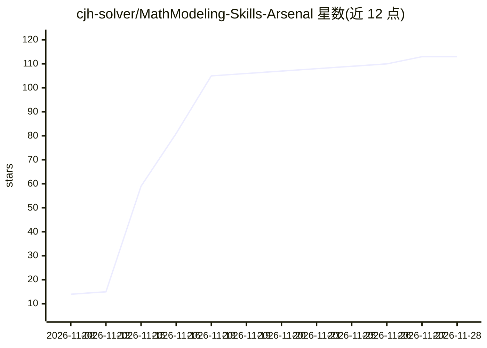

# cjh-solver/MathModeling-Skills-Arsenal

⭐ 113 · Python · Apache-2.0 · 推送 2026-11-20 · [GitHub](https://github.com/cjh-solver/MathModeling-Skills-Arsenal) · 个人维护 · 中文 README

**数学建模竞赛的 AI Agent 技能集与本地工作台**

面向国赛、美赛、MathorCup 等数学建模竞赛的技能集合：提供 35 个覆盖读题建模、求解、数据分析、科研绘图、LaTeX 论文写作与终稿评审的 SKILL.md 技能，采用 skills/分类/技能 结构，可安装到 Codex、Claude Code 等宿主的技能目录。另含本地工作台，读取已有 Harness 项目并集中查看比赛阶段、小问、角色会话与成果，页面从项目文件同步且不调用模型。主控为开发快照，节点批准与最终交付由使用者负责。

## 筛选速览

| 维度 | 判定 | 备注 |
|---|---|---|
| AI 角色 | `ai-knowledge` | 知识聚合/清单类 |
| 许可风险 | `permissive` | Apache-2.0 |
| 部署形态 | `None` |  |
| 模型依赖 | — | README 未给出锁定关系 |
| 硬件要求 | — | 无带数字的原话,不猜 |
| 安装摩擦 | `low` | 无编译、无系统依赖或容器化 |
| 成熟度 | `idea` | |

## 能力要点

- 35 个技能覆盖读题、建模、求解、绘图、写作与评审流程
- SKILL.md 结构，可安装到 Codex / Claude Code 等宿主技能目录
- 本地工作台读取项目文件展示阶段、会话与成果，无需调用模型
- 章节批准后图文并行的写作流程，人工逐章批准

## 适用场景

- 我参加数学建模竞赛，想让 AI 协助组织建模任务与论文交付
- 我只想解一问、画一张图或审稿时找到对应技能
- 查看已有比赛项目的阶段、会话与审查记录

## 场景标签

`科研工具` `数据分析` `AI 写作` · 领域:效率与自动化

## 证据(README 行号)

> L2:  数模军械库
> L3:  数模 Skills ＋ 本地工作台
> L42: 仓库使用 `skills/<分类>/<技能>/SKILL.md` 结构，安装时将技能目录放到宿主实际读取的技能根目录。以 Codex 用户技能目录为例：

## 星数曲线

2026-11-08 14 → 2026-11-28 113（+99）

---
*卡片 v1 · prompt 1.4 · 生成 2026-11-18 · 置信度 high · 依据 README sha `96c4be20b693` · [字段定义](../../DATASET.md)*
