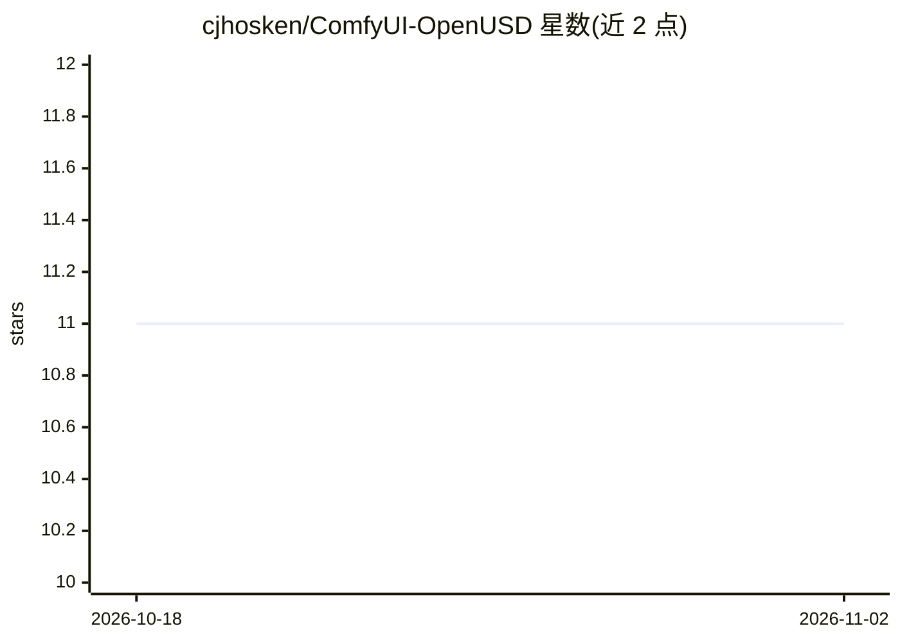

# cjhosken/ComfyUI-OpenUSD

⭐ 11 · JavaScript · GPL-3.0 · 推送 2026-09-24 · [GitHub](https://github.com/cjhosken/ComfyUI-OpenUSD) · [官网](https://registry.comfy.org/publishers/cjhosken/nodes/ComfyUI-OpenUSD) · 个人维护

**ComfyUI 的 OpenUSD 3D 场景集成节点包**

面向 ComfyUI 用户的开源节点扩展，将 Pixar 的 OpenUSD（通用场景描述）引入节点画布：支持在纯 Python 环境中将 .gltf/.glb 转换为 .usd/.usda/.usdc/.usdz 格式，提供 USDA ASCII 文本的在线查看与编辑组件，以及硬件加速的本地 3D 交互式预览视口，无需依赖外部 DCC 软件。安装方式为克隆仓库到 ComfyUI 的 custom_nodes 目录，运行依赖 usd-core、usd2gltf 与 trimesh。

## 筛选速览

| 维度 | 判定 | 备注 |
|---|---|---|
| AI 角色 | `ai-ecosystem` | LLM/agent 周边工具 |
| 许可风险 | `viral` | GPL-3.0 |
| 部署形态 | `None` |  |
| 模型依赖 | — | README 未给出锁定关系 |
| 硬件要求 | — | 无带数字的原话,不猜 |
| 安装摩擦 | `low` | 无编译、无系统依赖或容器化 |
| 成熟度 | — | 结构信号不足 |

## 能力要点

- 纯 Python 完成 glTF/glb 到 USD 系列格式转换
- ComfyUI 界面内直接查看与编辑 USDA ASCII 文本
- 硬件加速的本地 3D 交互式预览视口

## 适用场景

- 在 ComfyUI 工作流中转换与编辑 3D 资产格式
- 不使用外部 DCC 软件的情况下预览 USD 资产
- 在节点画布中组合 OpenUSD 场景与渲染流程

## 场景标签

 · 领域:3D/图形图像工具

## 证据(README 行号)

> L7:  An OpenUSD integration for ComfyUI
> L14: Bring the power of Pixar's **Universal Scene Description (OpenUSD)** directly into your ComfyUI node canvas. This e

## 星数曲线

2026-10-18 11 → 2026-11-02 11（+0）

---
*卡片 v1 · prompt 1.4 · 生成 2026-11-02 · 置信度 high · 依据 README sha `bfac3a365259` · [字段定义](../../DATASET.md)*
