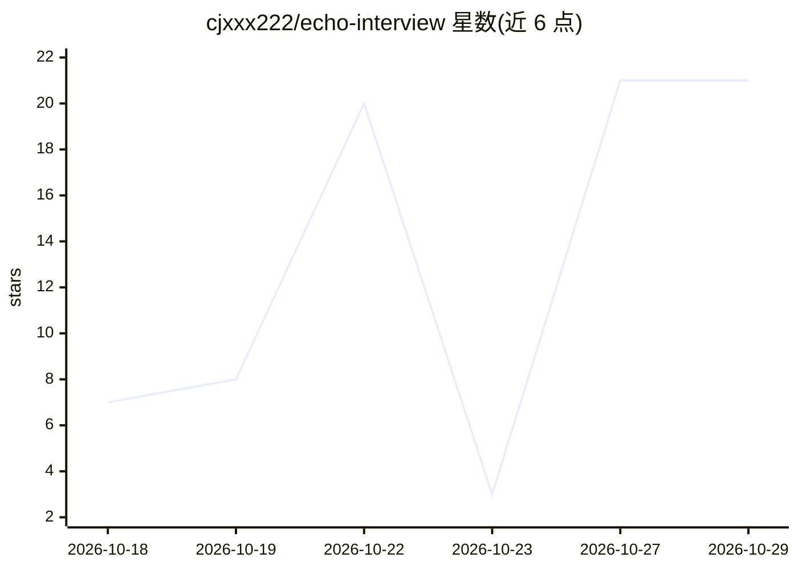

# cjxxx222/echo-interview

⭐ 21 · Python · MIT · 推送 2026-10-13 · [GitHub](https://github.com/cjxxx222/echo-interview) · 个人维护 · 中文 README

**AI 模拟面试官：多轮对话面试并产出带原文引用的评分报告**

面向求职者（MVP 限定 AI 产品经理方向文字面试）的模拟面试应用：上传简历后经多轮对话面试，输出四维度（结构25%/深度30%/岗位匹配25%/文字表达20%）加权评分报告。关键机制是每个扣分点强制引用候选人回答的逐字原文并由机器校验，编造引用会被重试或丢弃；评分权重由确定性代码计算。评分体系经真人背靠背盲评校准，评测集与统计代码开源。基于 FastAPI + Vue3 + LangGraph，面试数据仅存内存、30 天自动清除。需配置 LLM API key（示例为 DeepSeek）。

## 筛选速览

| 维度 | 判定 | 备注 |
|---|---|---|
| AI 角色 | `ai-native` | 本体是模型或模型工具 |
| 许可风险 | `permissive` | MIT |
| 部署形态 | `self-host` | docker 或自建部署 |
| 模型依赖 | locked-api |  |
| 硬件要求 | — | 无带数字的原话,不猜 |
| 安装摩擦 | `low` | 无编译、无系统依赖或容器化 |
| 成熟度 | — | 结构信号不足 |

## 能力要点

- 扣分点强制引用回答逐字原文，机器校验编造引用并重试/丢弃
- 四维度加权评分由确定性代码计算，非模型现编
- 真人盲评校准流程：导盲评包、免登录表单打分、Spearman 一致性统计
- 隐私设计：内置虚构示例简历，面试数据仅存内存 30 天自动清除

## 适用场景

- 求职前用 AI 模拟面试并查看带原文引用的评分报告
- 体验无需上传真实简历的完整面试流程
- 对 AI 评分与真人评分做一致性校准实验

## 场景标签

`模型评测` · 领域:评测与运维

## 证据(README 行号)

> L3: > AI 模拟面试官：上传简历 → 多轮对话面试 → 结构化评分报告。**每条扣分都挂对话原文，评分体系经真人盲评校准。**
> L7: 1. **可解释评分**：每个扣分点强制引用候选人回答的逐字原文（机器校验，模型编造引用会被重试/丢弃）
> L21: 四维度与权重（`backend/dimensions.py` 单一来源）：结构 25% / 深度 30% / 岗位匹配 25% / 文字表达 20%。

## 星数曲线

2026-10-18 7 → 2026-10-29 21（+14）

---
*卡片 v1 · prompt 1.4 · 生成 2026-10-28 · 置信度 high · 依据 README sha `d792d3d6f160` · [字段定义](../../DATASET.md)*
