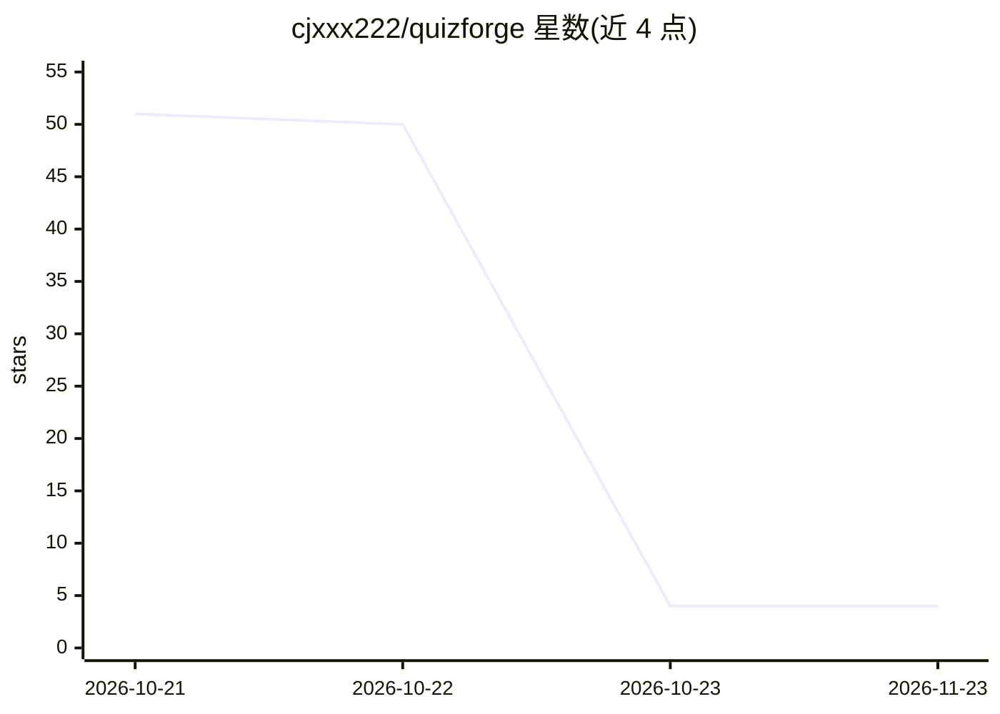

# cjxxx222/quizforge

⭐ 4 · Python · 推送 2026-10-14 · [GitHub](https://github.com/cjxxx222/quizforge) · 个人维护 · 中文 README

**给备考者：PDF 题库自动抽取与间隔重复刷题系统**

导入题库 PDF，通过规则解析优先、DeepSeek LLM 兜底不规则块、入库前校验的抽取管道生成结构化题库（题干/选项/答案/解析/题型），带隔离区转人工机制。刷题侧提供三池加权抽题、Leitner 间隔重复、错题本与练习度量，Streamlit 五页面界面复用 CLI 同一引擎。答错可选触发开放域 RAG 生成带引用讲解（博查搜索+白名单重排）。LLM 输出强制过 Schema 校验，无答案线索的题块禁止 LLM 兜底。SQLite 存储，无 GPU 依赖。

## 筛选速览

| 维度 | 判定 | 备注 |
|---|---|---|
| AI 角色 | `ai-native` | 本体是模型或模型工具 |
| 许可风险 | `none` | — |
| 部署形态 | `library` | 以包/库形式分发 |
| 模型依赖 | locked-api |  |
| 硬件要求 | — | 无带数字的原话,不猜 |
| 安装摩擦 | `low` | 无编译、无系统依赖或容器化 |
| 成熟度 | — | 结构信号不足 |

## 能力要点

- 规则优先 + LLM 兜底的抽取管道，全量入库前自动校验并带隔离区归因
- 无答案线索的题块禁止 LLM 兜底，避免把模型猜测教给用户
- 三池加权抽题 + Leitner 间隔重复 + 错题本，判分零 LLM 调用
- 答错后可选生成带引用讲解，来源白名单重排并落库网页快照

## 适用场景

- 把粗糙格式的大型题库 PDF 整理成可刷题的结构化题库
- 按间隔重复和错题优先策略安排日常复习
- 备考时对答错的题自动生成带出处的知识点讲解

## 场景标签

`文档解析` `RAG` · 领域:知识与检索

## 证据(README 行号)

> L3: 把一个大型题库 PDF 导入系统，自动抽取成结构化题库（题干 / 选项 / 答案 / 解析 / 题型），随后以**随机抽题 + 错题优先 + 间隔重复**的策略驱动刷题，即时判分、即时看解析、沉淀错题本与统计。
> L5: 技术核心是**半结构化题库的高质量结构化抽取管道**：规则解析优先，DeepSeek LLM 兜底不规则块，全量入库前自动校验。**零 GPU 依赖、无向量数据库、LLM 月成本预算 ¥50 以内。**
> L89: 答错后自动生成**带引用的知识点讲解**：题干 → 查询构造 → 博查搜索 → 来源白名单重排 → 上下文组装 → DeepSeek 生成（强制引用编号）→ 讲解与网页快照落库。

## 星数曲线

2026-10-21 51 → 2026-11-23 4（-47）

---
*卡片 v1 · prompt 1.4 · 生成 2026-11-21 · 置信度 high · 依据 README sha `c9f474762d4e` · [字段定义](../../DATASET.md)*
