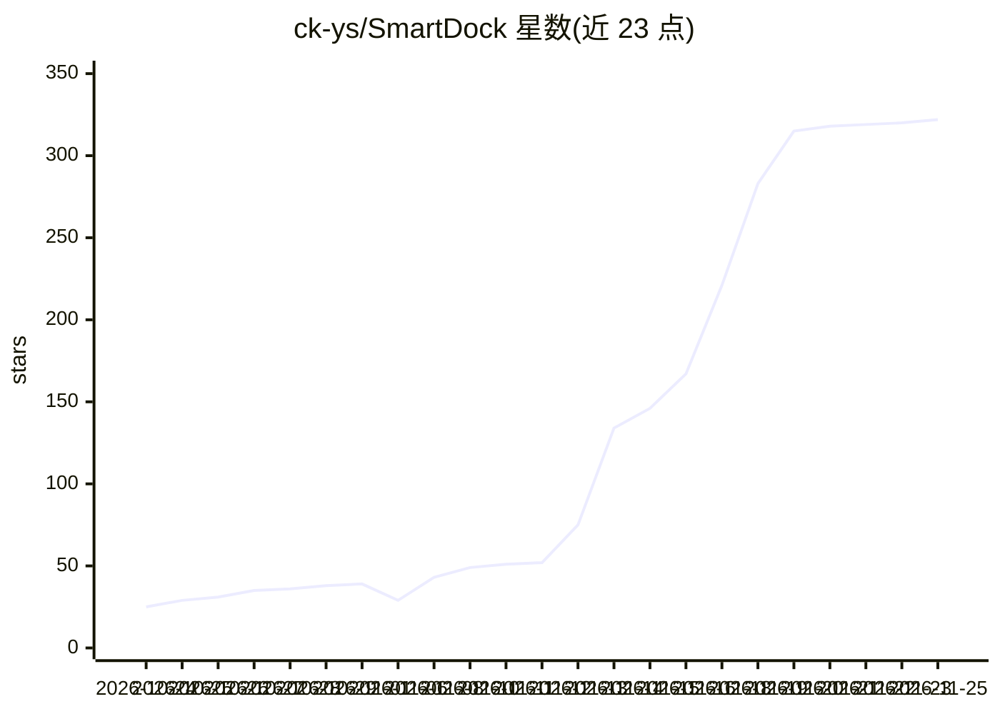

# ck-ys/SmartDock

⭐ 322 · Java · Apache-2.0 · 推送 2026-11-23 · [GitHub](https://github.com/ck-ys/SmartDock) · 个人维护 · 中文 README

**给团队用的开源智能体工作台引擎，附用户画像引擎**

基于 Java 21/Spring Boot 3.5/Vue 3.5 与 RuoYi-Vue-Plus 底座的开源智能体工作台：按 agentId 注册多智能体，ReAct 工具循环、工具 SPI 扩展业务能力、写操作 HITL 确认、PII 脱敏与计费（19 家预置供应商）。技能为 SKILL.md 格式 Markdown 文件，可在管理台在线编辑。配套事件源用户画像引擎（事件→指标→快照）。提供本地开发与 Docker Compose 两种部署方式；基线不含模型 Key，需自行录入。

## 筛选速览

| 维度 | 判定 | 备注 |
|---|---|---|
| AI 角色 | `ai-ecosystem` | LLM/agent 周边工具 |
| 许可风险 | `permissive` | Apache-2.0 |
| 部署形态 | `self-host` | docker 或自建部署 |
| 模型依赖 | — | README 未给出锁定关系 |
| 硬件要求 | — | 无带数字的原话,不猜 |
| 安装摩擦 | `low` | 无编译、无系统依赖或容器化 |
| 成熟度 | — | 结构信号不足 |

## 能力要点

- 多智能体注册与 ReAct 工具循环，AGUI/SSE 流式输出 28 类事件
- 工具 SPI（BizToolProvider）接入业务能力，写操作先确认再落库
- 技能为 SKILL.md 文件，管理台改完下一轮会话生效
- 事件源画像引擎：维度配置、评分、分群、快照回放

## 适用场景

- 给业务系统配一个能查真实数据、走真实流程的 AI 助手工作台
- 需要写操作确认、审计留痕与计费的内部智能体平台
- 想在业务动作上做用户画像评分与分群分析
- 以 RuoYi 底座为基础搭建带多租户权限的管理后台

## 场景标签

`多智能体` `AI 助手` `Agent 框架` · 领域:Agent 开发

## 证据(README 行号)

> L15: SmartDock 是一个**开源的智能体工作台**：左侧是会话，右侧是工作区，技能点一下就能开工，工具调用全程可见，写操作先确认再执行。它就是你在截图里看到的那个界面——不是 SDK 加一个聊天框的示例。
> L104: - **工具 SPI 机制**：业务能力通过 `BizToolProvider` 扩展，无需修改引擎核心
> L425: **它是参考实现，不是装上就能用的成品。** 两条引擎可以拆开单独复用（画像引擎不依赖智能体，智能体也不依赖画像），平台基线可以直接当脚手架改。上线前需要接入自己的模型 Key、替换默认口令，并完成所在组织要求的安全与合规评估。

## 星数曲线

2026-10-24 25 → 2026-11-25 322（+297）

---
*卡片 v1 · prompt 1.4 · 生成 2026-11-25 · 置信度 high · 依据 README sha `b04073c36ea5` · [字段定义](../../DATASET.md)*
