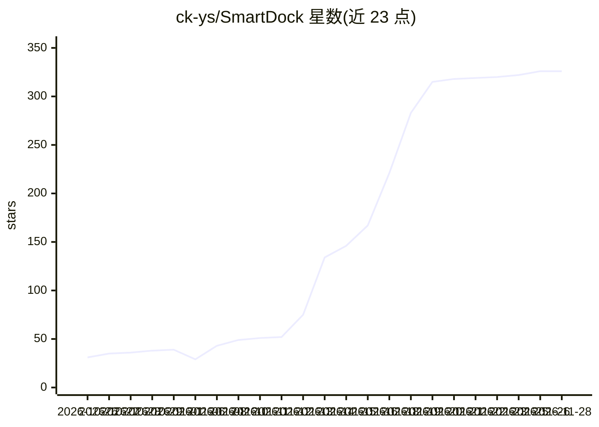

# ck-ys/SmartDock

⭐ 326 · Java · Apache-2.0 · 推送 2026-11-27 · [GitHub](https://github.com/ck-ys/SmartDock) · 个人维护 · 中文 README

**给企业团队的多智能体工作台：ReAct 工具调用+用户画像引擎**

基于 Java 21/Spring Boot 3.5/Vue 3.5 与 RuoYi-Vue-Plus 5.6.1 底座的开源智能体工作台：按 agentId 注册多智能体，走 ReAct 工具循环并经 AGUI/SSE 流式输出；业务能力通过工具 SPI（BizToolProvider）接入，写操作在落库前出 HITL 确认卡；技能为 SKILL.md 格式 Markdown 文件，支持三层装载与管理台在线编辑；配套事件源用户画像引擎（事件→维度→快照）。提供本地源码与 Docker Compose 两种部署方式，基线不含任何模型 Key，上线前需自配供应商 Key 并替换默认口令。

## 筛选速览

| 维度 | 判定 | 备注 |
|---|---|---|
| AI 角色 | `ai-ecosystem` | LLM/agent 周边工具 |
| 许可风险 | `permissive` | Apache-2.0 |
| 部署形态 | `self-host` | docker 或自建部署 |
| 模型依赖 | — | README 未给出锁定关系 |
| 硬件要求 | — | 无带数字的原话,不猜 |
| 安装摩擦 | `low` | 无编译、无系统依赖或容器化 |
| 成熟度 | — | 结构信号不足 |

## 能力要点

- 多智能体注册 + ReAct 工具循环，AGUI/SSE 流式输出（28 类事件）
- 工具 SPI 扩展业务能力，写操作 HITL 确认、PII 出网脱敏、计费系统
- 技能为 SKILL.md 文件，管理台在线编辑无需发版
- 配套事件源用户画像引擎，快照可回放可对账

## 适用场景

- 给团队搭一个带权限、审计与计费的智能体工作台
- 把业务 SOP 写成技能文件让 AI 按步骤执行
- 定时用只读工具跑自动化任务并推送结果
- 用事件数据构建用户画像与行为分析

## 场景标签

`多智能体` `Agent 框架` · 领域:Agent 开发

## 证据(README 行号)

> L15: SmartDock 是一个**开源的智能体工作台**：左侧是会话，右侧是工作区，技能点一下就能开工，工具调用全程可见，写操作先确认再执行。它就是你在截图里看到的那个界面——不是 SDK 加一个聊天框的示例。
> L103: - **ReAct 工具循环**：模型自主决策调用工具，全程流式输出（AGUI/SSE，28 类事件）
> L417: **适合**：想直接拿到一个能用、能改的智能体工作台的团队；需要多智能体注册、工具接入、权限与计费底座的项目；顺带想要用户画像与行为分析的团队。

## 星数曲线

2026-10-26 31 → 2026-11-28 326（+295）

---
*卡片 v1 · prompt 1.4 · 生成 2026-11-28 · 置信度 high · 依据 README sha `2f149288d630` · [字段定义](../../DATASET.md)*
