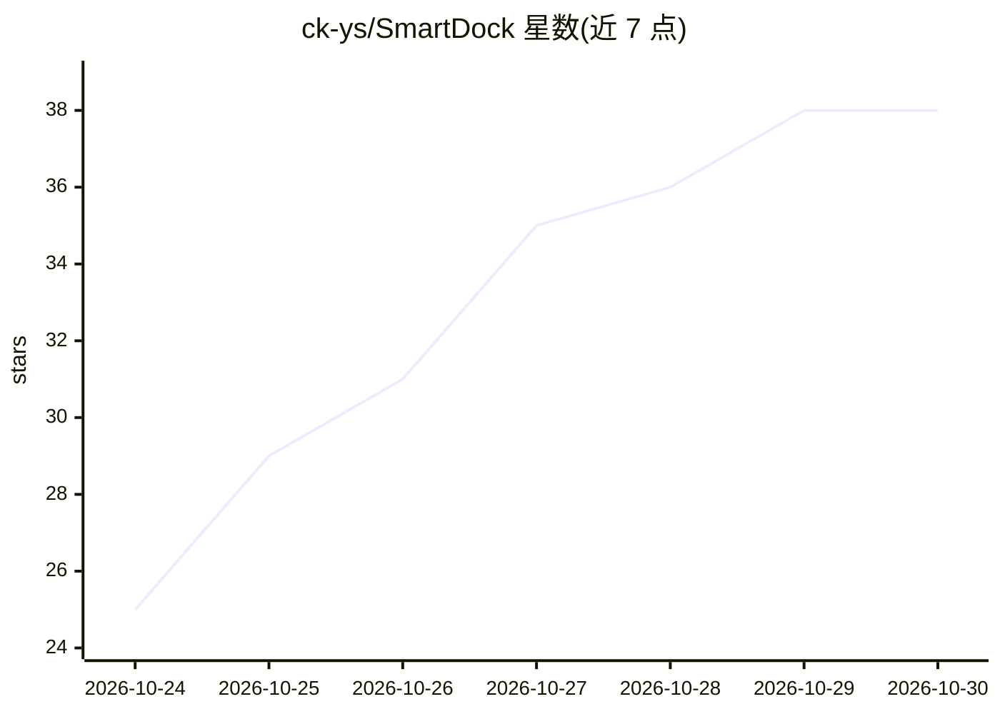

# ck-ys/SmartDock

⭐ 38 · Java · Apache-2.0 · 推送 2026-10-29 · [GitHub](https://github.com/ck-ys/SmartDock) · 个人维护 · 中文 README

**通用智能体引擎与用户画像引擎的参考实现，附企业级后台基座**

基于 AgentScope 2.0.3 ReActAgent 流式运行时构建的智能体引擎参考实现，提供多 agent 注册、ReAct 工具循环、工具 SPI 扩展、PII 脱敏、HITL 写操作确认与钱包/积分计费；同时内置事件源用户画像引擎（维度配置化、快照版本化）。平台基线继承 RuoYi-Vue-Plus 5.6.1，含多租户、权限、OSS、调度。基线不含任何模型 Key，上线前需自行配置供应商 Key、替换默认口令并完成安全合规评估。技术栈为 Java 21 / Spring Boot 3.5 / Spring AI / Vue 3.5 / PostgreSQL，后端 447 个 JUnit 用例。

## 筛选速览

| 维度 | 判定 | 备注 |
|---|---|---|
| AI 角色 | `ai-ecosystem` | LLM/agent 周边工具 |
| 许可风险 | `permissive` | Apache-2.0 |
| 部署形态 | `self-host` | docker 或自建部署 |
| 模型依赖 | — | README 未给出锁定关系 |
| 硬件要求 | — | 无带数字的原话,不猜 |
| 安装摩擦 | `low` | 无编译、无系统依赖或容器化 |
| 成熟度 | — | 结构信号不足 |

## 能力要点

- 多智能体注册与 ReAct 工具循环，全程流式输出
- 工具 SPI（BizToolProvider）扩展业务能力，无需改引擎核心
- PII 出网脱敏、工具结果注入打标、HITL 写操作确认
- 事件源画像引擎：维度配置化、快照版本化、可回放对账

## 适用场景

- 在企业后台中接入多智能体并按 agentId 路由与计费
- 通过配置化事件与维度为业务主体构建用户画像
- 基于 RuoYi 平台基线二次开发带 AI 助手的管理系统

## 场景标签

`多智能体` `Agent 框架` · 领域:Agent 开发

## 证据(README 行号)

> L14: SmartDock 是一套**通用智能体（Agent）引擎**与**用户画像引擎**的参考实现，基于 AgentScope 2.0.3 ReActAgent 的流式运行时构建。项目内置完整的企业级平台基线（多租户、权限、OSS、调
> L16: > 定位：参考实现（reference implementation），不是免配置的生产成品。上线前需要接入自己的模型 Key、替换默认口令，并完成所在组织要求的安全与合规评估。
> L24: - **多智能体注册**：按 `agentId` 注册与路由，共用工具注册、权限、记忆、技能与计费

## 星数曲线

2026-10-24 25 → 2026-10-30 38（+13）

---
*卡片 v1 · prompt 1.4 · 生成 2026-10-26 · 置信度 high · 依据 README sha `a43e00286f19` · [字段定义](../../DATASET.md)*
