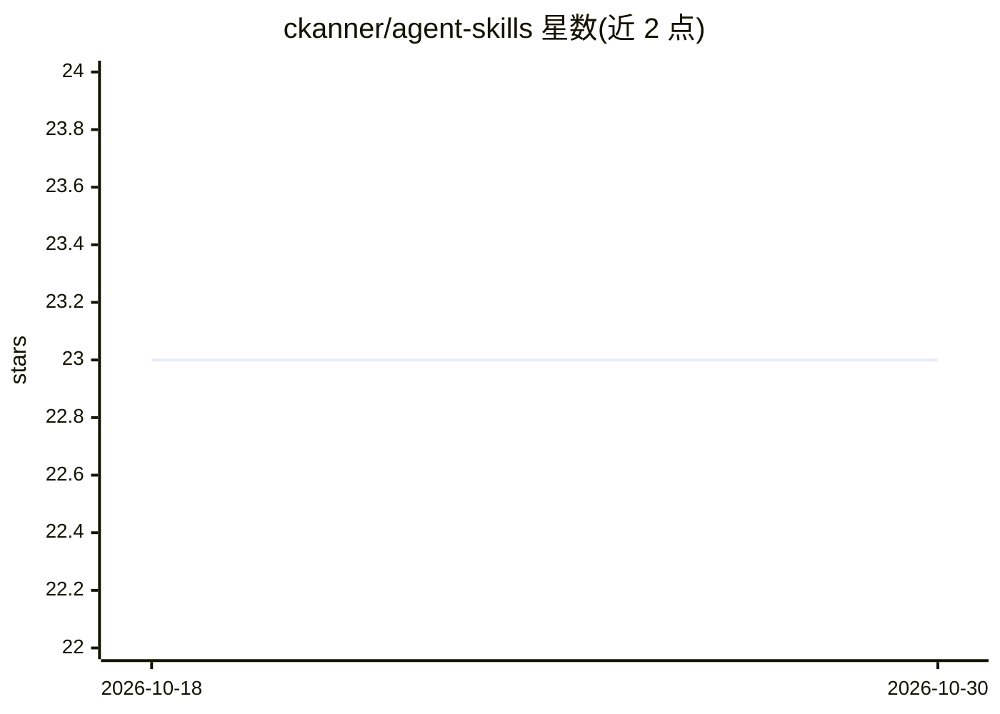

# ckanner/agent-skills

⭐ 23 · Shell · Apache-2.0 · 推送 2026-10-03 · [GitHub](https://github.com/ckanner/agent-skills) · 个人维护 · 中文 README

**面向 Claude 的 Agent Skills 技能合集（含 3 个技能）**

个人维护的 Claude Agent Skills 集合，收录 3 个技能：Prompt Optimizer（将模糊提示词改写为结构化指令）、Jta（JSON 国际化文件多语言翻译，带 agentic 反思机制、支持 27 种语言、增量模式，依赖 jta CLI 与 OpenAI/Anthropic/Gemini API key）、UI Automation（通过 codex exec 委托浏览器/桌面自动化并留存截图证据，依赖 Codex CLI）。每个技能遵循标准 SKILL.md 结构，可通过 Claude Code 插件市场、团队配置、git clone、Claude.ai 上传 ZIP 或 Anthropic API 方式安装使用。

## 筛选速览

| 维度 | 判定 | 备注 |
|---|---|---|
| AI 角色 | `ai-knowledge` | 知识聚合/清单类 |
| 许可风险 | `permissive` | Apache-2.0 |
| 部署形态 | `None` |  |
| 模型依赖 | — | README 未给出锁定关系 |
| 硬件要求 | — | 无带数字的原话,不猜 |
| 安装摩擦 | `low` | 无编译、无系统依赖或容器化 |
| 成熟度 | — | 结构信号不足 |

## 能力要点

- 3 个技能：提示词优化、JSON i18n 翻译（27 语言）、UI 自动化验证
- Jta 支持 agentic 翻译（3x API 调用）与增量模式（节省 80-90% API 成本）
- 提供 Claude Code 插件市场、团队 settings.json 自动安装、Claude.ai ZIP 上传与 API 多渠道接入
- 技能遵循标准 Agent Skills 格式（SKILL.md + 可选 examples/scripts/references）

## 适用场景

- 为 Claude Code / Claude.ai 添加提示词优化能力
- 让 agent 自动翻译 JSON 国际化文件并保持术语与格式一致
- 让 agent 通过浏览器或桌面自动化验证发布后的 UI 并留存截图证据

## 场景标签

`提示工程` `GUI 自动化` `AI 写作` · 领域:Agent 开发

## 证据(README 行号)

> L5: A curated collection of Claude Agent Skills designed to enhance AI workflows with specialized capabilities.
> L243: Agent Skills are modular capabilities that extend what AI agents can do. They consist of instructions, scripts, an
> L249: ```

## 星数曲线



2026-10-18 23 → 2026-10-30 23（+0）


---
*卡片 v1 · prompt 1.4 · 生成 2026-10-27 · 置信度 high · 依据 README sha `d88ef2638328` · [字段定义](../../DATASET.md)*
