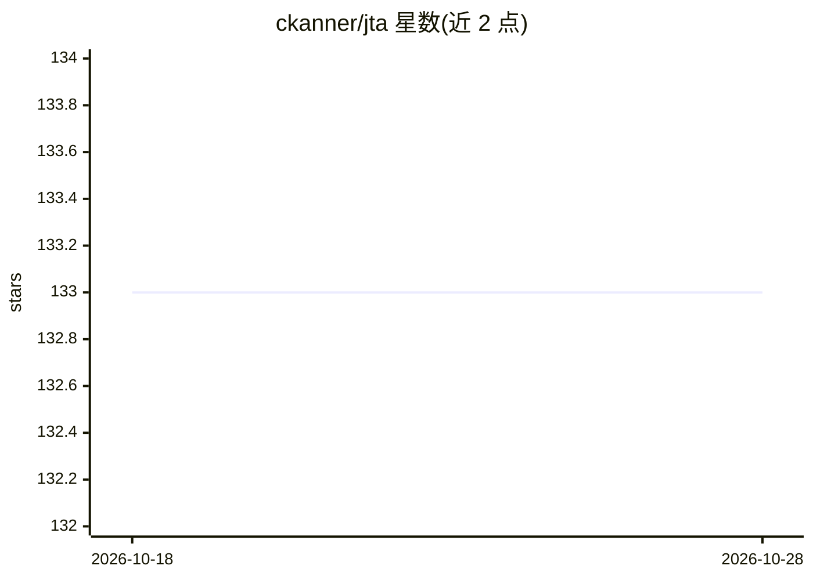

# ckanner/jta

⭐ 133 · Go · MIT · 推送 2025-11-12 · [GitHub](https://github.com/ckanner/jta) · 个人维护 · 中文 README

**AI 翻译 JSON i18n 文件的命令行工具，带反思自优化**

Go 编写的命令行工具，读取 JSON 国际化文件并调用 LLM 完成翻译，支持 27 种语言。核心机制为 Agentic 反思：先翻译、再由 AI 按准确性/流畅度/风格/术语四维评估并自我改进，代价是每批次约 3 倍 API 调用。另含自动术语检测（可编辑术语词典）、占位符/HTML/URL/Markdown 格式保护、增量翻译（更新时降低 80-90% 成本）与 RTL 语言处理。支持 OpenAI、Anthropic、Gemini 三类 API，提供 Homebrew/二进制/go install/源码安装，并可打包为 Claude 类 agent 的 Skill。

## 筛选速览

| 维度 | 判定 | 备注 |
|---|---|---|
| AI 角色 | `ai-native` | 本体是模型或模型工具 |
| 许可风险 | `permissive` | MIT |
| 部署形态 | `desktop` | 安装包/桌面程序 |
| 模型依赖 | locked-api |  |
| 硬件要求 | — | 无带数字的原话,不猜 |
| 安装摩擦 | `low` | 无编译、无系统依赖或容器化 |
| 成熟度 | — | 结构信号不足 |

## 能力要点

- translate → reflect → improve 循环的 Agentic 反思翻译机制
- LLM 自动检测术语并生成可编辑的 .jta 术语词典目录
- 增量翻译模式仅处理新增/修改内容（更新成本降低 80-90%）
- 占位符、HTML 标签、URL、Markdown 的格式自动保护

## 适用场景

- 把项目的 en.json 批量翻译为多语言 i18n 文件
- 频繁更新文案时用增量模式节省翻译 API 成本
- 通过术语词典保持品牌名与领域术语的翻译一致性
- 作为 Claude agent Skill 让 AI 代理自动调用完成翻译

## 场景标签

`AI 写作` · 领域:内容生成

## 证据(README 行号)

> L14: Jta is a production-ready command-line tool that uses AI to translate JSON internationalization files with **except
> L121: - **OpenAI**: All models including GPT-5, GPT-5 mini, GPT-5 nano, GPT-4o, etc.
> L22: Jta can be used as an Agent Skill to enable AI agents like Claude to automatically translate JSON i18n files.

## 星数曲线

2026-10-18 133 → 2026-10-28 133（+0）

---
*卡片 v1 · prompt 1.4 · 生成 2026-10-22 · 置信度 high · 依据 README sha `0bf940674dce` · [字段定义](../../DATASET.md)*
