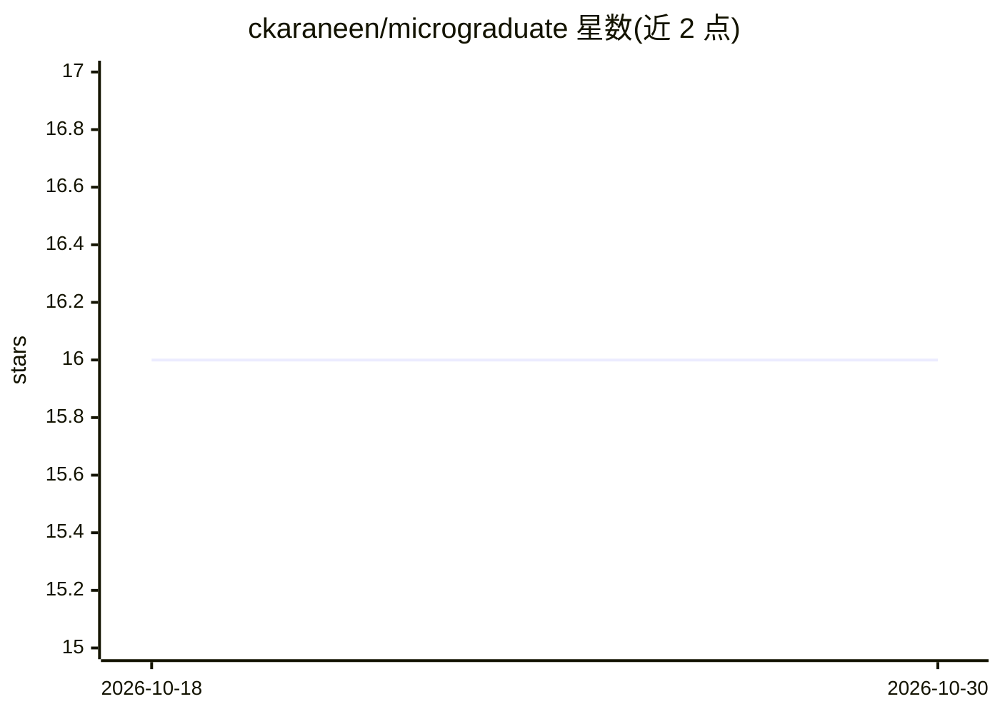

# ckaraneen/micrograduate

⭐ 16 · Jupyter Notebook · MIT · 推送 2026-01-28 · [GitHub](https://github.com/ckaraneen/micrograduate) · [官网](https://micrograduate-book.github.io/) · 个人维护

**神经网络基础自学课程：从反向传播到 GPT 的笔记本教程**

自包含的神经网络入门课程，内容覆盖 micrograd 自动微分、makemore 系列语言建模与 picoGPT，共 7 个 Jupyter 笔记本，构建于 Andrej Karpathy 的 Zero to Hero 系列与 Jay Mody 的 picoGPT 等工作之上。提供在线书籍（GitHub Pages）与 Colab 一键运行入口；本地运行需克隆仓库并用 conda 环境文件与 requirements.txt 安装依赖。面向神经网络初学者与自学者。

## 筛选速览

| 维度 | 判定 | 备注 |
|---|---|---|
| AI 角色 | `ai-knowledge` | 知识聚合/清单类 |
| 许可风险 | `permissive` | MIT |
| 部署形态 | `library` | 以包/库形式分发 |
| 模型依赖 | — | README 未给出锁定关系 |
| 硬件要求 | — | 无带数字的原话,不猜 |
| 安装摩擦 | `low` | 无编译、无系统依赖或容器化 |
| 成熟度 | — | 结构信号不足 |

## 能力要点

- 7 个笔记本覆盖 micrograd、makemore 1-5、picoGPT
- 每个笔记本提供 Open In Colab 在线运行入口
- 配套在线书籍 micrograduate-book.github.io
- 本地运行提供 conda 环境文件与依赖清单

## 适用场景

- 系统学习从反向传播到 GPT 的神经网络基础
- 在 Colab 上免配置运行课程笔记本
- 跟随 Karpathy Zero to Hero 风格教程自学深度学习

## 场景标签

`教程课程` · 领域:学习与行业

## 证据(README 行号)

> L8: A self-contained course to learn the basics of neural networks: from backprop to GPT!
> L20: |1|**micrograd**|Open In Colab|

## 星数曲线

2026-10-18 16 → 2026-10-30 16（+0）

---
*卡片 v1 · prompt 1.4 · 生成 2026-10-30 · 置信度 mid · 依据 README sha `60b3ce7c12fb` · [字段定义](../../DATASET.md)*
