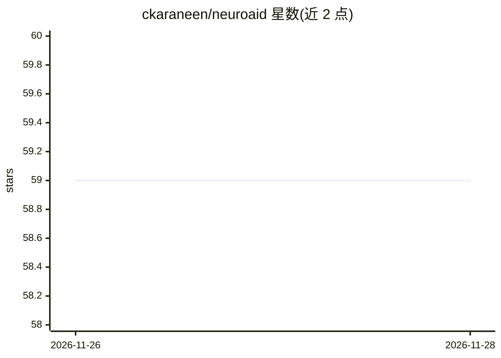

# ckaraneen/neuroaid

⭐ 59 · MIT · 推送 2026-11-24 · [GitHub](https://github.com/ckaraneen/neuroaid) · 个人维护

**神经科学与 AI 交叉领域的入门论文与资源清单**

面向 Neuro-AI 入门者整理的论文、课程、数据集与工具导航清单。将领域划分为四种含义（神经网络作为脑模型、机器学习分析神经数据、神经科学启发 AI、脑与 AI 的共同计算问题），提供 Top 12 精选阅读顺序、三条按背景区分的入门路线（ML/CS、生物/心理学、临床/神经科技），并用 ★、L1-L3 难度、preprint 标记与 Colab 实操练习组织条目，另含模型-脑比较的方法学评估入门。

## 筛选速览

| 维度 | 判定 | 备注 |
|---|---|---|
| AI 角色 | `ai-knowledge` | 知识聚合/清单类 |
| 许可风险 | `permissive` | MIT |
| 部署形态 | `None` |  |
| 模型依赖 | — | README 未给出锁定关系 |
| 硬件要求 | — | 无带数字的原话,不猜 |
| 安装摩擦 | `low` | 无编译、无系统依赖或容器化 |
| 成熟度 | — | 结构信号不足 |

## 能力要点

- Top 12 入门阅读列表与三条按背景定制的入门路线
- L1-L3 难度分级与 ★ 起点标记
- 包含 Colab 实操练习与神经数据分析工具（nilearn、MNE-Python 等）
- 模型-脑比较的方法学评估清单与常见误区提示

## 适用场景

- 从机器学习背景转入计算神经科学方向
- 神经科学背景学习者补充深度学习基础
- 查找神经数据分析工具与大规模数据集
- 了解 Neuro-AI 领域的代表性论文与争议观点

## 场景标签

`教程课程` `精选清单` · 领域:学习与行业

## 证据(README 行号)

> L3: :zap: :books: Papers, courses, datasets and tools for getting started with **Neuro-AI**! :brain: :boom:
> L7: > New here? Start with the Top 12, then pick an entry track.

## 星数曲线

2026-11-26 59 → 2026-11-28 59（+0）

---
*卡片 v1 · prompt 1.4 · 生成 2026-11-26 · 置信度 high · 依据 README sha `c50f7df73574` · [字段定义](../../DATASET.md)*
